# Changes Made - November 18, 2026

## v0.2.48 — November 23, 2026 (Windows and Linux)

- **The launcher's updater panel works again** ([#60](https://github.com/DivinusX/a-port-of-the-order-1886-thats-actually-alive/issues/60)).
  Pressing **Download update** made the button vanish, greyed out **Check for updates** and left
  "Update state unavailable" on screen: the window read the update status through a binding that
  delivers a structured object, while the panel parsed it as JSON text — every progress poll threw
  and the panel fell back to "no state". The reader now accepts both shapes, and a failed poll
  keeps the last known state instead of collapsing the panel mid-download.
- Downloads report live progress again (the poller is the only progress channel), and Check →
  Download → Install is exercisable from the window on Windows and Linux.

Verified: launcher-go Go tests pass with the staged frontend; the frontend unit tests gained four
cases (object shape, absent response, corrupt text keeps state, downloading keeps its cancel
action); the rebuilt Linux window binary embeds the patched bundle.

## v0.2.47 — November 23, 2026 (Windows and Linux)

- **Xbox button prompts work again** ([#59](https://github.com/DivinusX/a-port-of-the-order-1886-thats-actually-alive/issues/59)).
  Players on an Xbox controller were shown PlayStation buttons: a preparation-script revision had
  retired the Xbox prompt set (falling back to the game's own art with only a log line) while the
  launcher still offered Xbox as a choice. The set is restored: the game's own bitmaps are kept and
  only the PlayStation marking inside each prompt is replaced by the matching Xbox letter, in the
  source's own ink, softness and alpha. The D-pad is identical on both pads, so its art stays.
- Prompt builds now work on dumps whose 1.02 update was extracted beside the base game or whose
  folders use different letter case: resources are found through the case-tolerant resolver, and an
  unmerged dump gets a clear message pointing at `scripts/order1886_merge_update.py` instead of a
  misleading "this game has no …" error that pushed players to PlayStation prompts.
- Keyboard and mouse prompts keep following your current key bindings.
- New check (`tests/test_order1886_button_prompts.py`): the offered sets, the plan's Xbox roles and
  the shipped mark art must stay consistent — a silently retired set now fails the tests.

Verified on Linux (RX 9070 XT) with **CUSA00785 – USA, updated to 1.02**: the dump merged with
`order1886_merge_update.py` (93 files), the Xbox set rebuilt 131 bitmaps from the player's own
art (the new `A` sits in the game's own ring; outside pixels unchanged); the full test suite
passes. In-game rendering is confirmed by playtest on the shipped launcher.
Same engine binaries as v0.2.46; the fix lives in the preparation scripts.

## v0.2.45 — November 22, 2026 (Windows and Linux)

- **Fixed button-mash QTEs losing progress above 30 FPS** ([#43](https://github.com/DivinusX/a-port-of-the-order-1886-thats-actually-alive/issues/43)).
  On matching game builds, each tap is worth at least as much as it is at 30 FPS.
  No frame-rate cap, turbo, or cheat is needed. The fix does not change hold or stick prompts.
- Maintainer playtest: the prologue guard QTE passed at 60 FPS on Linux (CUSA00785 01.02).
  Windows gameplay was not separately tested.
- Thanks to Wontell for reporting it and linking the [upstream investigation](https://github.com/saxons-kicks/theorder1886-port/issues/101).

Both packages use [build source `eb047a6`](https://github.com/DivinusX/The-Order-1886_pc/commit/eb047a64bbda135b7d246fa57fdb4636f40653b5).

## v0.2.44-go-preview.1 — Windows and Linux preview

- Fixed a shader constant read that could use the wrong slot when its address could not
  be resolved ahead of time. The runtime rebuilds affected shader caches as needed.
- No face dots were observed in local play on CUSA00785 (Linux, Radeon RX 9070 XT).
  The unpatched comparison did not reproduce the reported small dots either.
  [Issue #27](https://github.com/DivinusX/a-port-of-the-order-1886-thats-actually-alive/issues/27)
  stays open for Windows/NVIDIA retesting. The separate `ReadLane` diagnostic is unchanged.
- Based on v0.2.43, with DLSS still bundled on Windows and FSR 4 assets included on both platforms.

Both packages were built from [runtime source `f5a4c54`](https://github.com/DivinusX/The-Order-1886_pc/commit/f5a4c54e32f2b4e764eb925ac680b5dd51e81fd6).
The [Windows build](https://github.com/DivinusX/The-Order-1886_pc/actions/runs/44990872298),
[Linux build](https://github.com/DivinusX/The-Order-1886_pc/actions/runs/44990872197) and
[preview checks](https://github.com/DivinusX/The-Order-1886_pc/actions/runs/44990858581)
passed. The finalized Linux archive also passed its portable smoke test.

## v0.2.43 — November 20, 2026 (Windows and Linux)

### Fixed: DLSS was selectable but could never work — the files were never shipped (#46)

- The port's DLSS path is real: it replaces the game's temporal resolve with DLSS Super
  Resolution using the game's own motion vectors and depth, through NVIDIA's official SDK
  runtime. But the Windows package never contained the DLSS bridge or `nvngx_dlss.dll`, so
  every DLSS choice logged `order1886_dlss.dll is not next to the runtime` and silently
  presented FSR 1 instead. Nobody could make it work; the files simply were not there.
- Windows packages now ship both DLLs plus NVIDIA's license notice, and the build pipeline
  **refuses to produce a package that is missing either one**. RTX users who pick
  **DLSS (DLAA) + FSR 1** (launcher) or **DLSS** in F1 > Screen > Upscaling now get the
  boot log line `Upscaler provider dlss: ... available` and DLSS in the frame.
- The bridge is built against the hash-pinned official NVIDIA DLSS SDK 310.9.16; its CPU
  contract tests run in CI. **Not verified by us:** the NGX path on RTX hardware — we
  develop on AMD. The first real check is #46's reporter; the provider reports failures
  loudly by design, never silently.
- Linux: DLSS stays unavailable (NVIDIA-only path); nothing changes there.
- **Known issues** carried from v0.2.42: the chapter-load hang (#40) is still open with the
  log cap shipped; button-mash QTEs above 30 FPS remain too fast (#43, community patch
  regressed in play); 32:9 and wider goes black (#32, engine limit ~2.4:1); pause-menu
  *Restart from checkpoint* mis-highlight; intermittent `Device lost` (exit 23) after save
  loads; Mesa 26.3.1 crashes at 3840 wide on RX 9000; world-prompt symbols can show an
  empty circle.

Verified on Windows CI (build + package content assertions + bridge CPU contracts at
44845378164); native tests pass on Windows and Linux. **Not verified:** DLSS on a physical
RTX machine (awaiting #46 confirmation), a physical Windows PC in general.

## v0.2.42 — November 20, 2026 (Windows and Linux)

### Fixed: screenshots now land in the game's own folder (#42)

- F12 captures used to save deep inside the user tree (`user/order1886/gpu/.../screenshots`)
  while the notice made you look in `user/screenshots` — players found an "empty" folder and
  reported lost screenshots.
- Captures now save to a **`Screenshots` folder in the game's own folder**, next to the
  launcher, with the file name in the notice. Diagnostic and test layouts keep the old path.

### Changed: the cinematic band fills ANY window shape, not just 21:9 (#45)

- F1 > Screen: the toggle is now **"Cinematic picture fills the window"**. The mechanism
  always adapted to any window shape; only the label claimed 21:9. It crops the game's
  2.4:1 picture to fit: no leftover bars at 21:9 or 2.4:1, thin bars at 20:9 (Sunshine and
  Moonlight stream resolutions), side bars at wider shapes. Changes right away, remembered.
- Verified on virtual displays: at 20:9 (2560x1152) the game renders full-bleed natively —
  title, lift cutscene and the drowning struggle all fill the frame with UI anchored.
- **Known limit (issue #32):** very wide shapes like 32:9 go black — the game engine itself
  stops rendering past about 2.4:1. That needs a different fix and is tracked separately.
- **Known issue:** the chapter-load hang (#40) is still open; v0.2.41's log cap ships here
  too, so a stuck session stays readable.
- **Known issue:** button-mash QTEs above 30 FPS are still too fast (#43): we tested the
  community patch and it made presses worse; 30 FPS remains the reliable rate there.
- **Known issue:** pause menu — *Restart from checkpoint* is shown greyed out and the
  highlight skips it, but the game still counts it. Being investigated.
- **Known issue:** an intermittent GPU stop (`Device lost`, exit 23) can happen right after a
  save finishes loading; relaunch if it happens.
- **Known issue (Linux, RX 9000 / RDNA 4):** Mesa 26.3.1 crashes this game at 3840 wide; use
  26.2.x for native 4K.
- **Known bug:** world-prompt button symbols can show as an empty circle (still investigated).

Verified on Linux (RX 9070 XT, Ryzen 9 9900X) with **CUSA00785 – USA, updated to 1.02**
(APP_VER 01.02): F12 on a standard-layout install wrote the PNG to `<game>/Screenshots`
(headless proof); the F1 row renders and persists at 20:9; native tests pass on Windows and
Linux CI. **Not verified:** a physical Windows PC; 32:9 (see the known limit above).

## v0.2.41 — November 20, 2026 (Windows and Linux)

### Changed: a stuck session cannot write a multi-gigabyte log any more (#40, partial)

- Some shader families of the game cannot have their descriptor tables flattened, so they
  compile with a fallback and are **recompiled fresh every session** (this is deliberate: the
  fallback layout must not be replayed from the cache). In one reported session the same
  failure lines were written 33 million times — 1.9 GB of log in under an hour — which buried
  everything a diagnosis needs.
- The port now gives each shader a **budget of 64 failure lines per session**. When a shader
  runs out, one line says so ("detail budget reached; later failures are suppressed while the
  fallback persists") and it stays quiet after that. The `First instruction is not
  s_mov_b32...` warning now **names its shader** and repeats at most three times per shader.
- **This release does not yet fix the chapter-load hang itself.** In that report the endless
  log came from **the game's own error reporter** looping while it waits for the chapter; the
  hang is being tracked on #40 with the reporter's logs. Gameplay is otherwise unchanged.
- **Known issue (the reported hang):** a chapter transition can stop loading forever with the
  process still alive; relaunch, and if it happens, keep the log. #40 asks affected players for
  a few greps that tell us which of the two remaining causes it is.
- **Known issue:** pause menu — *Restart from checkpoint* is shown greyed out and the highlight
  skips it, but the game still counts it; first press on *Quit to title* restarts from the
  checkpoint. Being investigated.
- **Known issue:** an intermittent GPU stop (`Device lost`, exit 23) can happen right after a
  save finishes loading; relaunch if it happens. Still investigated.
- **Known issue (Linux, RX 9000 / RDNA 4):** Mesa 26.3.1 crashes this game at 3840 wide on the
  first frame.
- **Known bug:** world-prompt button symbols can show as an empty circle (still investigated).

Verified on Linux (RX 9070 XT, Ryzen 9 9900X) with **CUSA00785 – USA, updated to 1.02**
(APP_VER 01.02): a full boot + menu session on the new build capped each failing shader at its
single-compile detail count, the new warning format appears, and no behavior changed; native
tests pass on Windows and Linux CI, including a new test of the log budget (its state machine,
per-shader independence, and 8-thread shared accounting). **Not verified:** the reporter's
machine (Windows, RTX 5070 Ti — the hang itself is not fixed by this release), a physical
Windows PC.

## v0.2.40 — November 20, 2026 (Windows and Linux)

### Fixed: the prologue's lift cutscene above 30 FPS (#38, #33)

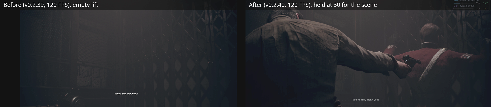

- Above the native 30 FPS, the lift in the prologue carried the camera away from the characters:
  shots of the empty cage, the camera inside Galahad's head, models and the revolver missing, and
  voices that faded out. Only this scene did it.
- The port now holds **30 FPS during that cutscene only**, from its first shot to the checkpoint
  the game saves when the next scene starts, then goes back to your frame rate by itself. Your
  setting is not changed; **F1 > Frame rate** says when the scene is holding it.
- **Known bug: pause menu.** *Restart from checkpoint* is shown greyed out and the highlight skips
  it, but the game still counts it: the first time the highlight is on *Quit to title*, choosing it
  restarts from the checkpoint. Press down once more for the real *Quit to title*. It also happens
  at 30 FPS and without DLC; being investigated.
- **Known issue:** an intermittent GPU stop (`Device lost`, exit 23) can happen right after a save
  finishes loading; relaunch if it happens. Still investigated.
- **Known issue (Linux, RX 9000 / RDNA 4):** Mesa 26.3.1 crashes this game at 3840 wide on the
  first frame.
- **Known bug:** world-prompt button symbols can show as an empty circle (still investigated).

Verified on Linux (RX 9070 XT, Ryzen 9 9900X) with **CUSA00785 – USA, updated to 1.02** (base game
plus the 1.02 update; APP_VER 01.02): the bug reproduced at 60 and 120 FPS and not at 30; with the
fix, the owner played the lift at 60 and at 120 FPS (16:9, render 3840): correct shots, 30 FPS
during the scene, the chosen rate back after it. Native tests pass, including a new cutscene test.
**Not verified:** 90 FPS, a physical Windows PC, the missing-revolver shot from #38 (it never
reproduced here).

## v0.2.39 — November 20, 2026 (Windows and Linux)

### DLC support: The Knight's Arsenal and The Knight's Endurance (#39)

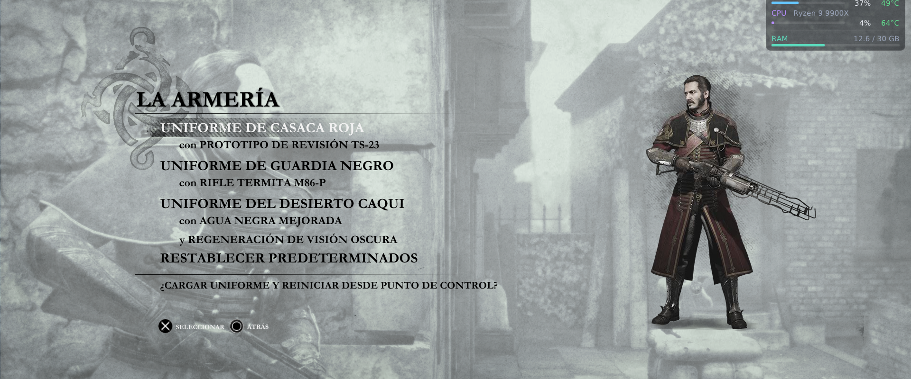

- **Launcher > Game > DLC folder:** choose the folder that holds your extracted DLC. Any of
  these works: the folder above the title ID, the title-ID folder (for example `CUSA00035`), or
  a single DLC folder (for example `TO1886GAMEDLC100`). Each DLC folder contains
  `sce_sys/param.sfo`. Leave it empty to play without DLC. Applies on the next launch.
- In game, the DLC appears in **Pause > La Armería / The Armory**:
  - **The Knight's Arsenal:** Redcoat uniform with the TS-23 revision prototype, and Black Watch
    uniform with the M86-P Termite Rifle.
  - **The Knight's Endurance:** Khaki desert uniform with improved Blackwater and Blacksight
    regeneration.
- DLC from any edition works with any edition of the game. The DLC files are only read, never
  changed. `logs/last-run.json` lists the DLC that was found.
- **Known issue:** an intermittent GPU stop (`Device lost`, exit 23) can happen right after a save
  finishes loading; it is not caused by the DLC and is being investigated. Relaunch if it happens.
- **Known issue (Linux, RX 9000 / RDNA 4):** Mesa 26.3.1 crashes this game at 3840 wide on the
  first frame.
- **Known bug:** world-prompt button symbols can show as an empty circle (still investigated).

Verified on Linux (RX 9070 XT, Ryzen 9 9900X) with **CUSA00785 – USA, updated to 1.02** (base game
plus the 1.02 update; APP_VER 01.02) and the CUSA00035 DLC folders: both DLC listed and mounted, the
game reads their files, and La Armería lists all three DLC uniforms (it does not open without the
DLC); the launcher passes the folder through to the game; native tests pass with clang, including a
new add-on content test. **Not verified:** a physical Windows PC, playing a full session in a DLC
uniform.

## v0.2.38 — November 19, 2026 (Windows and Linux)

- **Fixed: DLSS disappeared from F1 > Screen > Upscaling** (#33). Once you picked another option,
  DLSS left the list and could only be chosen again in the launcher. It now stays listed on PCs
  where it can run, and it is called **DLSS (DLAA) + FSR 1**, as in the launcher.
- The Upscaling description now says that FSR 1 does not run when the output matches the render
  size (so DLSS, FSR 3.1 or FSR 4 at a matching output use no FSR 1 at all).
- **Known issue (Linux, RX 9000 / RDNA 4):** Mesa 26.3.1 crashes this game at 3840 wide on the
  first frame; use Mesa 26.2.x for native 4K.
- **Known bug:** world-prompt button symbols can show as an empty circle (still investigated).

Verified on Linux (RX 9070 XT, Ryzen 9 9900X) with **CUSA00785 – USA, updated to 1.02** (base game
plus the 1.02 update; APP_VER 01.02): FSR 3.1 and FSR 4 still listed in the menu; FSR 4 ran at
native 3840x1600 for 1800 frames with no faults (Mesa 26.2.6); native tests pass with clang.
**Not verified:** DLSS itself (it needs Windows with an RTX GPU; none here).

## v0.2.37 — November 19, 2026 (Windows and Linux)

- **Fixed: the game could crash at startup, while preparing shaders** (#35). Since v0.2.33 the FPS
  counter checks the game's frame-rate setting on every frame. It could do that while the game's
  code was still being loaded and locked, and the read crashed the game
  (`Fault: read access to 00000008004507be`). The engine now waits until the game is fully loaded
  before the counter looks at it. It could happen to anyone with the FPS counter on.
- **Known issue (Linux, RX 9000 / RDNA 4):** Mesa 26.3.1 crashes this game at 3840 wide on the
  first frame; use Mesa 26.2.x for native 4K.
- **Known bug:** world-prompt button symbols can show as an empty circle (still investigated).

Verified on Linux (RX 9070 XT, Ryzen 9 9900X) with **CUSA00785 – USA, updated to 1.02** (base game
plus the 1.02 update; APP_VER 01.02): the crash reproduced by widening the loading window (the old
order faulted at `0x8004507be` in the overlay, exactly as in the report), and the fixed order loads
and runs normally with the FPS counter on; native tests pass with clang. **Not verified:** the
reporter's PC (Windows, RTX 4080 SUPER, CUSA00076).

## v0.2.36 — November 19, 2026 (Windows and Linux)

Render resolution, upscaling and sharpening in the in-game menu (**F1 > Graphics > Screen**).

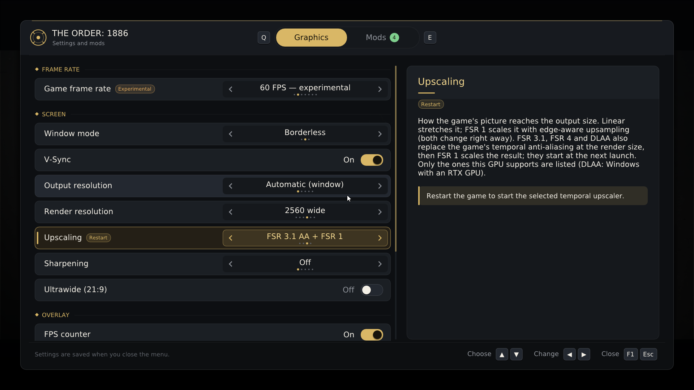

| Option | Choices | When it applies |
|---|---|---|
| **Render resolution** | 1280, 1600, 1920 (Original), 2560, 3200, 3840 (native 4K), or your custom launcher width | **Next launch.** The size the game itself renders at; the launcher prepares the game again for the new size. A **Restart** chip shows until you restart. |
| **Upscaling** | Linear, FSR 1, FSR 3.1 AA + FSR 1, FSR 4 + FSR 1, DLAA + FSR 1 | Linear and FSR 1 **right away**; FSR 3.1, FSR 4 and DLAA replace the game's temporal anti-aliasing and start at the **next launch**. Only the ones your GPU supports are listed (DLAA: Windows with an RTX GPU). |
| **Sharpening** | Off, 25 %, 50 %, 75 %, 100 % (AMD RCAS) | **Right away.** It says when it cannot run (Linear scaling to a larger output). |

- Choices are saved for the launcher too, so the next Play keeps what you picked in the menu.
- **Upscaling now works at every render resolution.** The launcher used to switch upscaling off
  (Linear, no FSR 3.1/4/DLAA) whenever the render width was not 1920; FSR 3.1 and FSR 4 now
  replace the game's resolve at the render size and FSR 1 scales the result to the output.

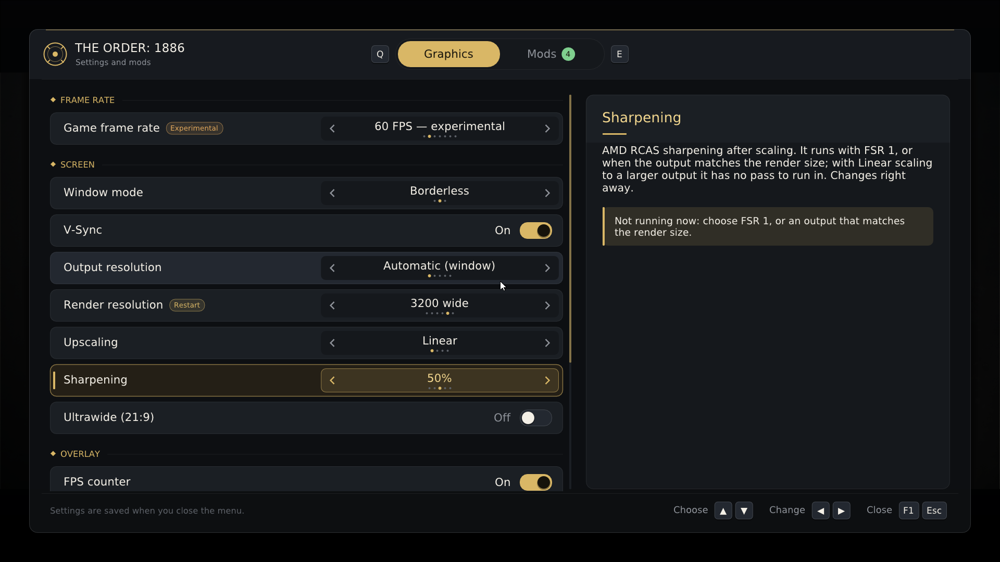

- **Known issue (Linux, RX 9000 / RDNA 4):** Mesa 26.3.1 crashes this game at 3840 wide on the
  first frame; use Mesa 26.2.x for native 4K.
- **Known bug:** world-prompt button symbols can show as an empty circle (still investigated).

Verified on Linux (RX 9070 XT, Ryzen 9 9900X) with **CUSA00785 – USA, updated to 1.02** (base game
plus the 1.02 update; APP_VER 01.02): FSR 3.1 and FSR 4 each replaced the resolve for 3600+ frames
at 2560x1067 with FSR 1 to a 3840x2160 output and no faults (headless, Mesa 26.2.6); the menu saves
the render width and sharpening to the launcher's settings and the upscaler to runtime.ini, which
the launcher imports; the owner used the new menu in a play session at 3840x1600 (it saved their FSR 4
choice; Mesa 26.2.6, 110 000+ frames, no faults); native tests pass with clang. **Not verified:** a render-resolution change carried
through the launcher by a player, FSR 3.1/FSR 4 at native 4K, DLAA (no RTX GPU here), a physical
Windows PC, a Steam Deck.

## v0.2.35 — November 19, 2026 (Windows and Linux)

Sharper picture at native resolution (#29) and a 4K-ready HUD.

### Temporal AA On/Off (F1 > Quality) (#29)

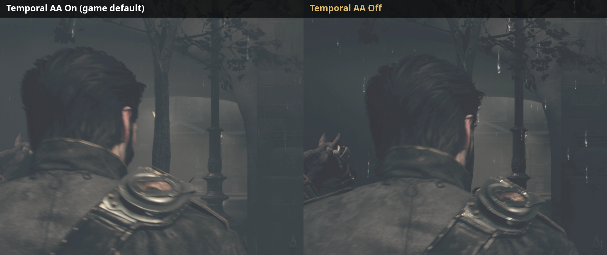

*Same spot, both crops brightened the same way so the detail is visible. The character moved a
little between the two captures.*

- The game's anti-aliasing blends the previous frame into its multisample resolve. At high
  render resolutions that blend is what makes the picture look soft, even at native 4K with
  Linear scaling, and it smears rain, hair and moving edges.
- **F1 > Quality > Temporal AA: Off** resolves the same multisample samples with the game's own
  weights and no blend: native-resolution rendering is sharp; thin edges shimmer a little when
  you move. **Changes right away**, saved in `user/order1886/graphics.ini`. On is the default
  (the game's own look); presets do not change it.
- With an upscaler selected in the launcher (FSR, DLSS), the upscaler replaces the game's
  temporal resolve, so this option has no effect there.

### Native 4K HUD and text

- **HUD and menus no longer break above 1920 wide.** The game's UI kept its five render
  targets in a fixed 32 MB pool sized for 1920x800; at higher render resolutions they did not
  fit, the HUD degraded and native-4K launches could stop at the first frame. The pool now grows
  with the render resolution. The game is prepared again once on the first launch.
- **Missing letters at 4K fixed** (font atlas glyphs disappeared at render widths above 1920).
- Maximum render width is now 4640 (4000 on 16:9 framing) because the larger UI pool shares the
  same GPU memory.

- **Known issue (Linux, RX 9000 / RDNA 4):** Mesa **26.3.1** (RADV) crashes this game at 3840 wide
  on the first frame (`Device lost`); Mesa 26.2.x with the same build is stable. This is a driver
  regression, not the port: use Mesa 26.2.x for native 4K until it is fixed.
- **Known bug:** world-prompt button symbols can show as an empty circle (still investigated).

Verified on Linux (RX 9070 XT, Ryzen 9 9900X) with **CUSA00785 – USA, updated to 1.02** (base game
plus the 1.02 update; APP_VER 01.02): Temporal AA Off confirmed by the owner in play at
2560x1067 and toggled live; 3600+ consecutive frames resolved without the blend at 3840x1600
(headless, Mesa 26.2.6) with zero faults; the 4K glyph fix confirmed by the owner in play at
3840x1600; native tests pass with clang. **The 4K HUD patches are checked against CUSA00785 1.02**;
other editions keep the old UI pool if their instructions differ. **Not verified:** the larger
UI pool at native 4K in play, a physical Windows PC, NVIDIA and Intel GPUs, a Steam Deck.

## v0.2.34 — November 18, 2026 (Windows and Linux)

Mods (#24) and a redesigned in-game menu (**F1**, or **R3 + L2** on a controller).

### Mods: cheats in F1 > Mods (#24)

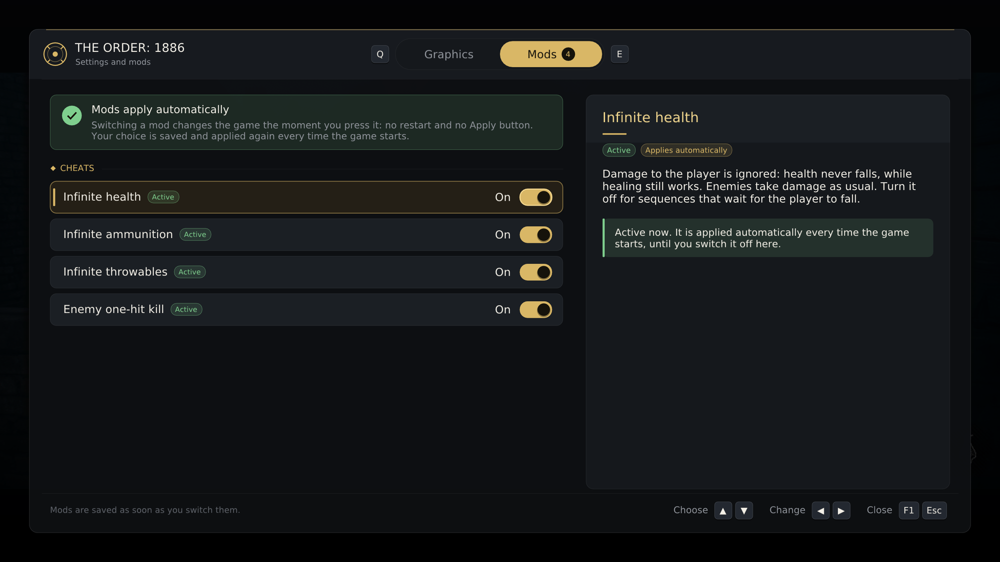

| Mod | What it does |
|---|---|
| **Infinite health** | Damage to you is ignored; enemies take damage as usual. |
| **Infinite ammunition** | Firing and reloading never use up rounds: magazine and reserve stay put. |
| **Infinite throwables** | Throwing a grenade (aimed or from the hip) never lowers the count. |
| **Enemy one-hit kill** | Any real hit on an enemy kills it. You are not affected. |

- **Mods apply automatically.** Switching one changes the game the moment you press it: no
  restart and no Apply button. Your choice is saved in `user/order1886/graphics.ini` and applied
  again every time the game starts, until you switch it off.
- Every mod checks the game's own instructions before it changes them. On a game version they
  were not verified on, the row shows **Unavailable** and nothing is changed.
- Infinite health tells you apart from enemies by how the game itself tracks you (enemies carry
  the AI's health listener, you carry the HUD's), so it works across chapters. Turn it off for
  scripted sequences that wait for the player to fall.

### Redesigned F1 menu

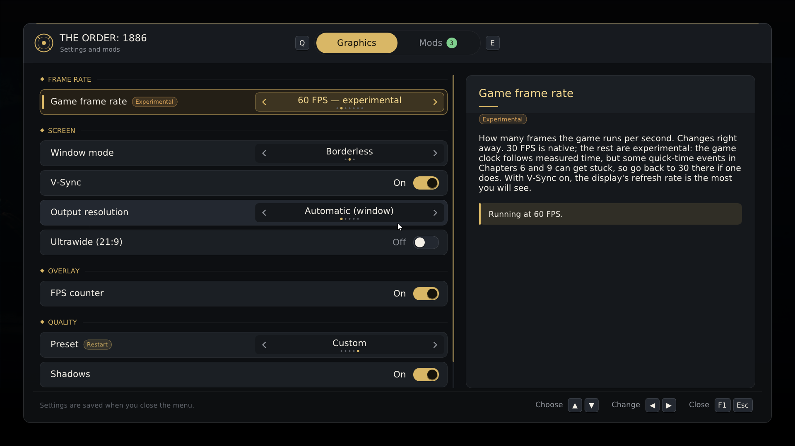

- New look: rounded panel, tab pills (Q / E, or L1 / R1) with a count of active mods, switches
  for On/Off options, position dots under choices, chips that flag **Experimental** and
  **Restart** options, and a description card with the current state of the focused option.
- Same keys, controller buttons and mouse clicks as before; the preset confirmation window got
  the same style.

- **Known bug:** world-prompt button symbols can show as an empty circle (still investigated).

Verified on Linux (RX 9070 XT, Ryzen 9 9900X) with **CUSA00785 – USA, updated to 1.02** (base game
plus the 1.02 update; APP_VER 01.02): all four mods accepted by the owner in play (health in two
different chapters, aimed and hip grenade throws, one-hit kills on 100 and 125-health enemies with
the player's health untouched); every patch site checked byte for byte against that game image;
the menu captured at 1920x1080; native tests pass with clang. **The mods are verified on CUSA00785
1.02 only**: on other editions they show Unavailable unless their instructions are identical.
**Not verified:** a physical Windows PC, NVIDIA and Intel GPUs, a Steam Deck, the new menu with a
controller.

## v0.2.33 — November 18, 2026 (Windows and Linux)

Three additions, all in the in-game menu (**F1**, or **R3 + L2** on a controller).

### New performance overlay

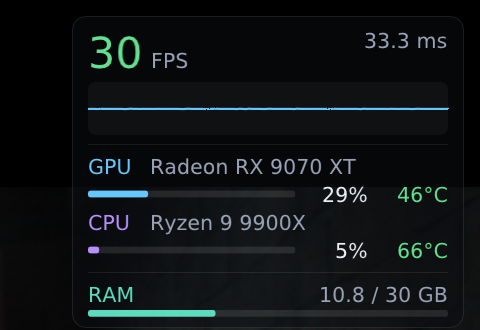

- The FPS counter is now a card: the game's frame rate large and coloured against its target
  (green on target, amber below, red far below), the frame time, and a graph of the last 120 frames
  where spikes show in red.
- **GPU and CPU**: model name, load bar, load % and **temperature** (green under 70 °C, amber under
  85 °C, red above). **VRAM and RAM** with bars.
- It adapts to the PC: what a system cannot report is left out instead of showing "n/a".
  - Linux: load and temperature for AMD GPUs (and the right GPU when an iGPU sits next to a discrete
    card), NVIDIA through the driver's NVML; CPU temperature from the usual sensors (`k10temp`,
    `coretemp`, `zenpower`). Before, Linux showed only the GPU name.
  - Windows: GPU/CPU load, RAM and VRAM; GPU temperature on NVIDIA cards. CPU temperature and
    AMD/Intel GPU temperatures are not available on Windows yet.

### Graphics presets (F1 > Quality)

| | Steam Deck | Low | Medium | High |
|---|---|---|---|---|
| Shadows | Off | Off | On | On |
| Anisotropic filtering | 2x | 2x | 8x | 16x |
| Frame rate | 30 | 30 | 60 | 60 |
| Render resolution | 1280 wide | unchanged | unchanged | unchanged |

| F1 > Quality | Preset confirmation |
|---|---|
| 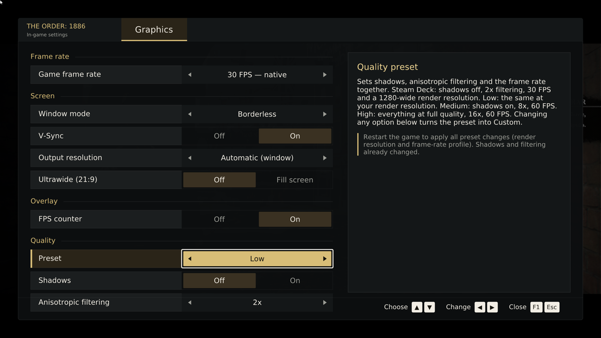 | 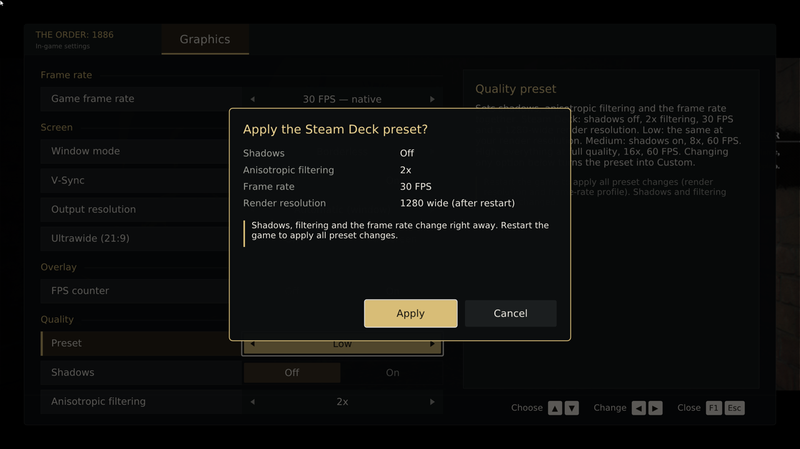 |

- Choosing a preset opens a window listing what it changes, with **Apply** and **Cancel**.
  Shadows, filtering and the frame rate change right away; **restart the game to apply
  all preset changes** (the render resolution and the launcher's frame-rate profile take effect on
  the next start, and the preset stores them in the launcher for you).
- **Shadows On/Off** and **Anisotropic filtering** can also be set one by one (the preset then
  shows Custom). They are saved in `user/order1886/graphics.ini`.
  - Shadows Off stops drawing the shadow maps: the scene is lit as if nothing cast a shadow. At
    1280x533 on the test PC the shadow maps took about 11% of the GPU frame time (0.68 of 6.06 ms),
    and their draw calls no longer cost the GPU thread anything.
  - Texture quality is not offered yet: lowering it also blurred the game's button-prompt icons.
    Textures stay at full quality in every preset.

| High | Steam Deck |
|---|---|
| 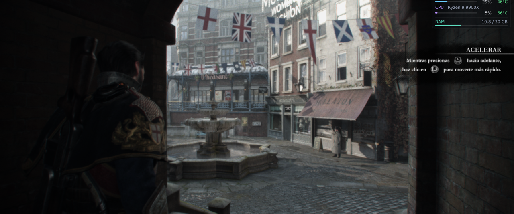 | 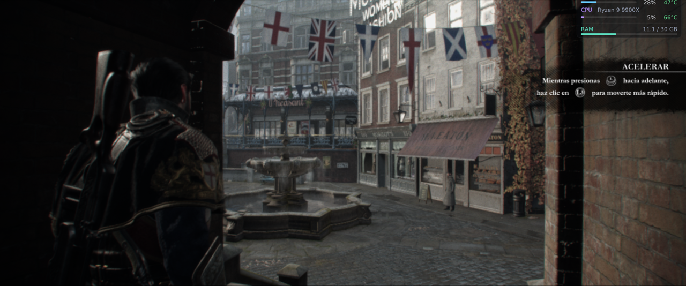 |

- **Frame rate fix:** the menu's **Unlocked** and 90+ FPS choices now really go past 60. A session
  started at 30 or 60 FPS kept the console's 60 Hz video sync, so the game never ran faster than
  60; it now switches to the fast sync the launcher's uncapped profiles use. Unlocked is capped at
  the display's refresh rate, at most 120 (above that the game's movement timing breaks).
  240 FPS was removed from the menu.

### Ultrawide 21:9 (#30)

- **F1 > Screen > Ultrawide (21:9): Fill screen.** The game's picture is 2.4:1, practically the
  shape of a 21:9 monitor, but it was drawn inside a 16:9 frame, so a 21:9 screen showed bars on
  all four sides. Fill screen shows only the picture, scaled to the window width: no bars on 21:9
  displays. Menus, subtitles and prompts stay inside the picture. Changes right away.
- Needs **Original** framing in the launcher (with 16:9 framing there are no bars to remove; the
  option says so). On 16:9 monitors it looks the same as before; on 32:9 the picture fills the
  height with bars at the sides (it is narrower than the screen).

| Off (21:9 screen) | Fill screen |
|---|---|
| 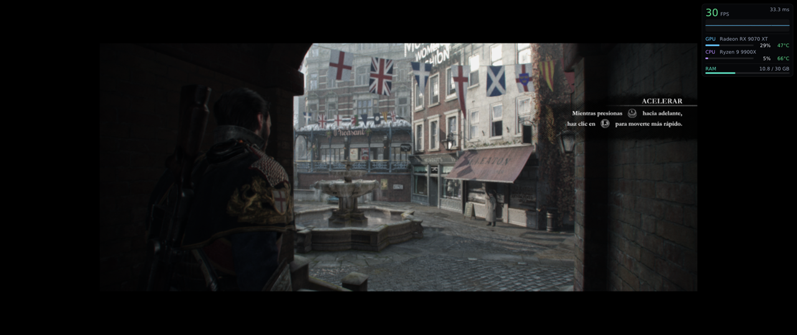 | 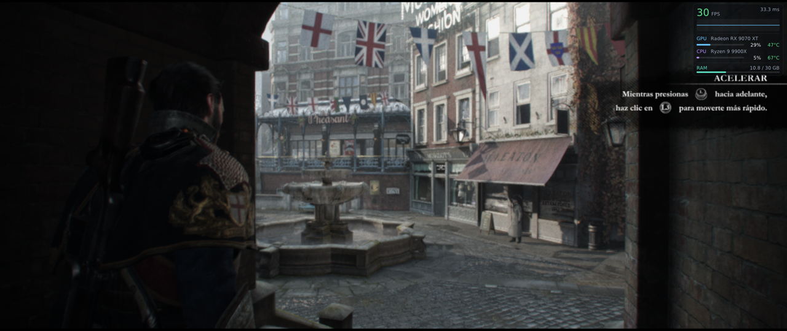 |

- **Known bug:** world-prompt button symbols can show as an empty circle (still investigated).

Verified on Linux (RX 9070 XT, Ryzen 9 9900X) with **CUSA00785 – USA, updated to 1.02** (base game plus the 1.02 update; APP_VER 01.02): the overlay, the presets (Steam Deck preset played
through a restart at 1280 wide) and the frame-rate choices in play; Shadows Off
measured at 1280x533; ultrawide on virtual 2560x1080, 3440x1440, 5120x1440 and 2560x1440 screens
(gamescope); native tests pass. **Not verified:** a physical ultrawide monitor, a physical Windows PC,
NVIDIA and Intel GPUs, a Steam Deck.

## v0.2.32 — November 17, 2026 (Windows and Linux)

- **GTX 10 (Pascal): colour flicker and black patches addressed, needs confirmation** (#26).
  v0.2.31 rendered the scene on these cards, but characters glowed in rainbow colours, brightness
  flickered and some surfaces were black. NVIDIA hardware does not interpolate the values the game
  packs into its shaders exactly (AMD does); GTX 10 cards now interpolate them by hand, as GTX 16 /
  RTX cards already did, and full-screen passes get the corner data they need for it. These GPUs
  rebuild their shader cache once more on the first launch.
- Other GPUs: no change in behaviour and no shader cache rebuild.
- **Known bug:** world-prompt button symbols can show as an empty circle (still investigated).

Verified on Linux (RX 9070 XT): GTX 10 behaviour reproduced by disabling barycentrics and forcing
NVIDIA-style interpolation, scenes render correctly with no Vulkan errors; normal path unchanged;
native tests pass. **Not verified:** a physical GTX 10 card, a physical Windows PC.

## v0.2.31 — November 17, 2026 (Windows and Linux)

- **GTX 10 (Pascal) cards render correctly** (#26). Without fragment-shader barycentrics the scene
  turned into silhouettes; a generated geometry shader now gives the pixel shaders the triangle
  corners and barycentrics they need. These GPUs rebuild their shader cache once on the first launch.
- **The launcher's file check passes** (#14). It reported 10 platform functions as missing (one was
  implemented but registered under a mistyped ID); all are provided now.
- **Crash reports show the cause** (#18): when the GPU library stops (exit 23), the launcher prints
  the reason from the GPU log (`GPU log: ...`) and stores it in `last-run.json`.
- **Asynchronous shaders are on by default again.** Turning them off did not fix the prompt symbols.
  If v0.2.30 turned them off on your install, you can switch them back on in the launcher.
- **Known bug:** world-prompt button symbols can show as an empty circle (still investigated).

Verified on Linux (RX 9070, Mesa 26.2.6): GTX 10 behaviour reproduced by disabling barycentrics,
scene renders with the fix; normal path unchanged (no cache rebuild); file check 0 missing;
native tests pass. **Not verified:** a physical GTX 10 card, a physical Windows PC.

## v0.2.30 — November 17, 2026 (Windows and Linux)

**No GPU hang, faster, and the speed optimization returns.**

- **Fixed: the GPU hang (exit 23).** The draw pipeline's constant ring lost track of which data the
  GPU had finished (its bookkeeping queue overflowed and dropped entries), so it looked full when
  it wasn't, and v0.2.27 then overwrote data still in use (GPU page fault, hang). The bookkeeping is
  fixed and the ring is 256 MB (was 32 MB; an interior uses ~25 MB per frame).
- **The two-stage draw pipeline is back on** (v0.2.28 had turned it off as a workaround).
- **Performance:** an interior that dropped to ~63 fps now runs at ~120 fps on the test PC.
- **Known bug:** the button symbol inside world interaction prompts can render as an empty circle.
  Still under investigation.

Verified on Linux (RX 9070, Mesa 26.2.6): no hang in 5-minute runs with the draw pipeline on (the
old ring hung in 37-120 s); ring statistics show 0 waits and 0 skipped uploads in play.
**Not verified:** a physical Windows PC.

## v0.2.29 — November 17, 2026 (Windows and Linux)

**Mouse look feels like a PC game, not an emulator.**

- Less input lag: mouse speed is averaged over 6 ms instead of a 25 ms smoothing filter.
- Small motion turns the camera: any movement jumps past the game's stick dead zone (radially, so
  diagonal aim keeps its angle), and a response curve lifts small and medium motion.
- **Set LOOK, AIM and SCOPE SENSITIVITY to 8 of 10** in the game's Options > Controls. The mouse
  drives the right stick, so the game's sensitivity sets the fastest possible turn.
- Lost the mouse after Esc? **Press F6** in the game window; no restart needed (#15).
- Fine-tuning by feel: `user/order1886/mouse-tuning.ini` (`window_ms`, `deadzone`, `curve`, `gain`)
  is re-read while the game runs.

Verified: tuned by feel in gameplay on Linux (RX 9070, launcher sensitivity 100, in-game 8 of 10);
unit tests and CI pass. **Not verified:** physical Windows, other mice and DPI settings. The game's
turn-speed ceiling and turn acceleration remain (a direct camera hook is planned).

**Known issue (since v0.2.28):** the round interaction prompt over things you can examine can show an
empty dark circle instead of the button symbol. v0.2.27 fixed it inside the two-stage draw pipeline,
which v0.2.28 turned off to stop the GPU hang (exit 23). The fix for both is the draw-pipeline race,
being worked on for v0.2.30. Also seen once: a shader-translation stop after 18 minutes
(`Unsupported FMask payload selectors`, exit 23); it did not reproduce from the same save.

## v0.2.28 — November 17, 2026 (Windows and Linux) — hotfix

**No more crash on launch from the shader cache (exit 139).** After some play, a launch could
crash half a second in with `Session failed (exit 139)`, inside the AMD driver
(`libvulkan_radeon.so`, stack `PipelineCache::WarmUp -> LoadGraphicsPipeline ->
CreateCachedGraphicsPipeline`), and keep crashing on every launch.

Cause (engine): while replaying the cache at boot, `LoadGraphicsPipeline` fills the shared
replay selection (`sel.infos`, `sel.modules`, `sel.fetch_shader`) stage by stage and returns early
when a stage fails (missing meta, refused fallback variant, missing SPIR-V) without clearing it.
The next pipeline then inherited the failed one's stages and was created with modules it does not
own, which crashed RADV. Since v0.2.26 refuses to replay fallback variants, failed loads are
routine, so a cache written by the same build could crash its own next boot (seen: 349 of 803
pipelines loaded, next boot crashed). Engine fix (both platforms): the replay selection is reset
before every cached pipeline and after the warm-up loop.

Launcher safety nets (`scripts/order1886_cache.py`, both platforms):

- The old per-user cache (`~/.local/share/shadPS4` / `%APPDATA%\shadPS4`) is **no longer copied**
  into the package (it only held caches from other builds); it is left untouched on disk.
- **Crash quarantine:** if the last boot died with a host fault inside the cache replay (read from
  `logs/last-run.json`), the next launch renames that title's cache to `<TITLE_ID>.crashed-<run>`
  and rebuilds it. Only the newest quarantine is kept; a shipped seed is skipped on that launch.

**In-app updates on Windows work again.** The v0.2.26 updater archive contained files the updater
refuses (`path is not package-owned: "CHANGES.md"`), so updating from inside the launcher failed.
`order1886-go-windows.zip` now holds only package files and passes the updater's `StageArchive`.

Verified (Linux, RX 9070, Mesa 26.2.6): a cache that crashed the v0.2.27 build at boot on every try
boots with this engine (407 of 1053 pipelines replayed, no crash); quarantine detection tested on
the real crash log; unit tests and CI pass. **Not verified:** physical Windows (same code,
CI-built).

**No more GPU hang a minute or two into play (exit 23), by turning an optimization off.** Sessions
could end with `Session failed (exit 23)`, "Device lost": the GPU read a page of a sparse buffer
arena before it was bound (every amdgpu dump shows a gfxhub page fault at the same address), the gfx
ring timed out and the kernel reset it. The trigger is the two-stage draw pipeline (draws recorded
on a second thread), which was on for every CPU with 8+ threads: with it on the game hung in 5 of 5
runs (37-120 s), with it off in none of 4 (up to 5 minutes, plus two short play sessions). It is now
off by default. Its root cause, a race, is still open; `ORDER1886_DRAW_PIPE=1` brings it back for
that investigation. Cost: the pipeline was measured upstream at +18-19% on 8-16 threads; not
re-measured here.

Verified (Linux, RX 9070, Mesa 26.2.6): see the run counts above. **Not verified:** physical
Windows; whether interaction-prompt glyphs (the v0.2.27 fix lives in the draw pipeline's constant
ring) render correctly on the non-pipelined path.

### In plain words (for players)

The game keeps a file of graphics "shortcuts" so it loads faster. When one shortcut couldn't be
used, the game accidentally mixed its leftovers into the next one, the graphics driver choked, and
the game closed half a second after you pressed Play, every time. That mix-up is fixed. As a
backup, if the game ever crashes while loading those shortcuts, it now throws the file away by
itself so the next launch works. You don't need to delete anything by hand.

The game could also freeze and close a minute or two into play ("exit 23"). That came from a speed
trick that does two things at once and sometimes got them out of order. It is switched off now, so
the game stays up. You may lose a little performance on some PCs; on the test PC it stayed smooth.

## v0.2.27 — November 17, 2026 (Windows and Linux)

**Interaction prompts stop depending on luck.** v0.2.26 made the glyph *pipeline* survive
cache replay; the symbol could still be missing or show the wrong button — and the same
save could look perfect in one session and broken in the next. Cause: each draw stages
its flattened user-data table into the 32 MB constant ring; when the ring tail was still
in flight on the GPU, the allocation failed and the upload was **silently skipped** — the
descriptor kept the previous draw's table. The prompt sprite then read another
interactable's glyph index (triangle where the trigger was meant) or a zeroed entry
(invisible symbol, crescent only). Whether a widget was poisoned depended on ring
pressure at packet-build time, so the wrong state persisted for the whole session and
only a checkpoint reload — packets rebuilt under different pressure — seemed to heal it.
Engine fix (runtime, both platforms): `ConstantRing::Allocate` resumes at the
GPU-retired frontier instead of failing, so an upload is only skipped if the GPU is
stalled across the entire ring (never observed). Launcher fix: `bin/order1886-launcher`
(the WebKit-free UI entry) now resolves the installation root from its `bin/` location
via `package-manifest.json` — launching it directly no longer reports "Order worker is
missing". Evidence: `docs/verification/2026-11-17-constant-ring-stale-uploads.md`.

Verified: instrumented desk visit — skipped uploads 162 → 0 across the same route; the
owner's own screenshots show newspaper, photo and weapon discs rendering their glyph on
the first pass after a checkpoint load, with the animation pulsing. **Not verified:**
physical Windows (same engine code path, CI-built).

## v0.2.26 — November 17, 2026 (Windows and Linux)

**World interaction prompts keep their button glyph, forever.** The dark disc over the
newspaper, photo or lantern could lose the triangle/circle inside it — subtitles and menus
unaffected — and the disc stayed empty on every later launch. Cause: shaders whose
extended-userdata flattening fails (the engine logs `SRT offset failure` and falls back to
reading the game's canonical tables) were saved to the pipeline cache without recording that
they are fallback variants. On replay the pipeline binds the flattened layout while the
saved binary reads canonical tables, so the glyph samples nothing and renders invisible.
Engine fix (runtime, both platforms): the fallback is now recorded in the serialized shader
meta, `LoadShaderMeta` refuses to replay flagged variants (they compile fresh — the
provably correct path, the same one that renders right today), and the meta format bumped
10 → 11, which invalidates every existing poisoned cache exactly once: the first launch
after updating recompiles (a few minutes of loading screens), then the cache is healthy
permanently. Evidence: `docs/verification/2026-11-17-srt-fallback-glyph.md`.

Verified: two-run replay test on the dev machine (run 1: `0 of 7328 replayed, 7328 stale` —
the bump rejects the old generation wholesale — then live recompile with 3,836 fallback
variants saved flagged; run 2: `340 replayed in 0.20 s`, flagged variants refused and
recompiled live, scene rendering pixel-identical). The owner additionally confirmed the
triangle glyph in person with the pruned cache. **Not verified:** physical Windows (same
engine code path, CI-built).

## v0.2.25 — November 17, 2026 (Windows and Linux) — regression hotfix

**Subtitles and button prompts are back with the bars off.** v0.2.24's CI-built packages
shipped an out-of-date `scripts/order1886_display.py` from the engine repository: the
v0.2.23 subtitle/UI-band/glyph patches had lived only in the port repository (hot-patched
into each release), so v0.2.24's re-preparation dropped `ui_fix` and reverted the bars-off
interface bug — subtitles and world prompts vanished whatever the game's subtitle setting
said. One file changed (identical in both packages and in the worker's copy):
`order1886_display.py` restored to the fixed revision (`107a9137…`, byte-identical to
v0.2.23's). The engine repository now carries it too, and the release check verifies every
port-owned script inside both packages against the port repository before publishing —
that drift can no longer pass silently. Everything else (binaries, seeds machinery, #17)
is unchanged from v0.2.24. Updating re-prepares once; `prepared.json` should record
`ui_fix: {applied: true, changed_sites: 9}`.

## v0.2.24 — November 17, 2026 (Windows and Linux)

**Shader cache seeds (#17): the pipeline cache now lives in the package, and a shipped seed
bundle can fill a fresh install before its very first launch.** Engine built from
`The-Order-1886_pc` branch `aot-shader-cache` (`bdd172d` + launcher Python only — the C++ is
byte-for-byte the v0.2.23 engine); new in both packages: `scripts/order1886_cache.py` (and the
worker's copy), the launcher overlay's `order1886_common.py`, and the seed step baked into the
worker's `order1886.py`. Evidence and method:
`docs/verification/2026-11-16-shader-cache-seeds.md`.

### Fixed: the pipeline cache was not in the package (Linux/SteamOS)

The launcher points the runtime at `user/order1886/gpu/native-ps4-v1` but nothing created
that folder, so the runtime — which treats a missing directory as "not the portable folder" —
silently fell back to `~/.local/share/shadPS4`. The README's self-contained state promise and
the launcher's own *Clear shader cache* action were pointing at an empty directory. Every
launch now creates the cache home first, and a pre-fix cache is copied into the package once
(never over an existing one; the old folder is left untouched).

### New: seed bundles — boot-time replay for fresh installs

The runtime replays cached pipelines while the game boots (that is the existing warm-up), but
a fresh install has nothing to replay: the game's shaders are not stored as plain program
objects in the dump (they stream decompressed, and the engine's permutations depend on
bindings only draws reveal), so nothing can translate them statically — the same reason native
PC ports ship a developer-captured cache. The port now has the matching mechanism:

- `<install>/shader-cache/<TITLE_ID>/` (a `bundle.json` + `blobs/` written by
  `export_shader_cache_seed`) is imported into an empty per-title cache before the first
  launch: staged, renamed atomically, every blob checked against the bundle's sha256 list,
  refused wholesale on tamper or a `shader_cache_abi` mismatch, and never touching a cache
  that has run a real session.
- The runtime's own `Shader::Profile` check stays the final word: a bundle captured on a
  matching GPU/driver replays from boot #1; a mismatching machine discards and rebuilds,
  exactly as today. Measured on this machine: importing the live 20,251-blob capture and
  booting logs **`Pipeline warm-up: 6992 of 6994 pipelines in 0.72 s`** where the empty cache
  logs 0 of 0.
- Capture your own with `python3 scripts/order1886_cache.py --export` (see QUICKSTART).
- **Official release packages contain no seed bundle:** bundles hold GPU code translated from
  the game's own shaders, so shipping one is the project owner's rights decision, not an
  engineering one. The mechanism is active the moment a bundle lands in `shader-cache/`.

### Verified / not verified

- Unit tests on both repos (port 32 OK, engine cache module 20 OK); the four pre-existing
  engine codegen test failures reproduce identically at `bdd172d` without these changes.
- Migration, import and replay verified live against the real CUSA00035 capture and a
  headless boot (gamescope, isolated state, no player state touched).
- **Not verified:** the Windows package on Windows (same Python, untested on that path);
  Steam Deck/SteamOS specifics of the fallback-directory adoption.

## v0.2.23 — November 16, 2026 (Windows and Linux)

**Subtitles and button prompts work with the bars off, and subtitle letters come out right.**
Same engine, worker and launcher binaries as v0.2.22 (`bdd172d`); one file changed in both
packages: `scripts/order1886_display.py` (and the worker's copy of it under
`bin/order1886-worker/_internal/scripts/`). The fix is applied when the game is prepared, so the
first launch after updating prepares it again. Original game files are never modified.
Evidence and method: `docs/verification/2026-11-16-ui-band-and-glyph-cache.md`.

### Fixed: no subtitles and no button prompts with Cinematic bars disabled

With **Graphics → Cinematic bars → Disabled** (the default since v0.2.14) subtitles never
appeared even with the game's own Subtitles option on, the Triangle/Cross prompts of world
interactions and QTEs were missing, and the menus were drawn about 5% too large. With the bars
enabled all of it worked.

Cause: the game's interface is Flash, authored for the 2.4:1 band (a 1920x800 stage), and the
game sizes it with the scene size. The 16:9 recipe makes the scene 1920x1080, so the stage was
laid out against 1080 rows.

- The interface now always gets the 2.4:1 band (`width x width*5/12`) and is drawn centred on
  the full 16:9 picture: menus, subtitles, objectives and prompts sit where they sit with the
  bars on, over a picture with no bars.
- Prompts attached to an object in the world are projected into that band, so the glyph stays
  on the object.
- With the bars enabled nothing changes: the band is the scene.
- It is computed from the render size at run time, not baked for 1920x1080.

### Fixed: wrong or late letters in subtitles ("Eigan." for "Sigan.")

The first time a letter was needed (a capital, an accented vowel) the subtitle could show
another letter in its place, or the line arrived late. The game copies each new letter into
its font texture with a compute shader, through a view of that texture with a different
format; the runtime kept that view as a separate image and the texture that is actually drawn
received the letter late or not at all. Both views now keep the texture's own format, so the
copy lands in the texture that is drawn. This one applied with the bars on too.

### Verified / not verified

- CUSA00035 1.02, Linux, RX 9070 XT (RADV), 16:9, 60 FPS, FSR 4, Español (Latinoamérica), on a
  copy of the state folder with scripted input and frame dumps: main and pause menus at their
  original scale and centred; every subtitle line of the first minute of the Prologue, with
  "Sigan." spelled right; the Triangle prompt of a world interaction (a beam in a tunnel), within a pixel of
  where the bars-on run puts it; the same route with the bars on unchanged; the launcher's own
  preparation records `display_profile.ui_fix = {applied: true, changed_sites: 9}`.
- **Not verified:** the Windows package on Windows (it carries the same script and the same
  game bytes are patched; nobody ran it); render widths other than 1920; long QTE sequences and
  the Lycan evade prompts; whole chapters.
- A prompt whose object is in the top or bottom ~13% of the 16:9 picture is outside the
  interface band: it is clamped to the band's edge.
- An executable whose bytes differ at any of the nine sites keeps its own interface code and
  `prepared.json` says why (`ui_fix.reason`); preparation never fails because of this fix.

## v0.2.22 — November 15, 2026 (Windows and Linux)

**One source revision, two packages.** Both are built by the source repository's CI from
`DivinusX/The-Order-1886_pc` branch `windows-port-v0.2.22`, revision `bdd172d` = the v0.2.18
`windows-port` line + the two November 14 runtime patches + the launcher changes below,
committed in the source tree instead of applied as a worker overlay, + the Linux packaging
and worker fixes that building the Linux package in CI for the first time required (below).
`bin/runtime-build.json` in each package binds its runtime to that revision
(`source_dirty: false`).

- **Windows x86-64** (`order1886-win-x86_64-v0.2.22.zip`): `order1886-go-package.yml` on
  `windows-2025` / MSYS2 CLANG64 (run `43678050101`), finalized with
  `packaging/windows/order1886-win-package.py`. The first Windows download with the
  November 14 fixes; v0.2.18 was the v0.2.17 engine.
- **Linux x86-64** (`order1886-linux-x86_64-v0.2.22.tar.gz`): `order1886-go-linux-package.yml`
  on `ubuntu-24.04` (run `43678115443`), finalized with the new
  `packaging/linux/order1886-linux-package.py` (FSR 4 bundle, music and release documents
  merged in; `order1886-bundle.py check` must pass; manifest and tarball rebuilt).
  Functionally v0.2.21 plus the preparation change under *Game language* below. Because the
  CI builds on Ubuntu 24.04, this package needs **glibc 2.39+** again, not the 2.44 that
  v0.2.19–v0.2.21 (built on Arch) required.

### Fixed: black stripes on RX 6600-class GPUs (#4)

The RDNA2 depth-lines patch (`docs/verification/2026-11-14-rdna2-ms-depth-lines.patch`,
merged in #7) ships in a download for the first time. On `VK_DRIVER_ID_AMD_PROPRIETARY` the
runtime creates the game's multisampled images with one sample, so the driver never reads
compressed multisampled depth from a shader; every other driver keeps the native baseline.
The reporter's log from v0.2.18 said `GPU: guest multisampling on`; this build says
`GPU: guest multisampling off (single-sampled images for this driver; ...)` on that driver.
Not yet confirmed on an RX 6600 — #4 stays open until an owner reports back.

### New on Windows (already on Linux since v0.2.19–v0.2.21): in-game menu (F1), game language, pre-patched copies

- **In-game menu on F1** — the v0.2.21 runtime patch; `game_menu` on by default in the
  launcher (`docs/verification/2026-11-14-in-game-menu.md`).
- **Game & Content → Game language** — the v0.2.20 feature: 21 languages, the SKU 0
  language filter removed at preparation. In the source tree this is now an explicit
  best-effort preparation step (`order1886_patches.apply_language`, recorded as
  `language_profile` in `prepared.json` and `last-run.json`) instead of a recipe hidden
  inside the catalogue selection: a build whose bytes differ at the SKU table keeps its own
  filter and says why, rather than refusing to prepare. The pt-BR → pt-PT substitution is
  gone, as on Linux.
- **Pre-patched dumps** (#3) — the v0.2.19 fix for copies whose `eboot.bin` already carries
  the 60 FPS or 16:9 patch.
- Launcher window: centred search magnifier (v0.2.20) and the three logo PNGs the vendored
  frontend referenced but the v0.2.18 package did not carry.

### Fixed on Linux: what the first CI-built Linux package revealed

Booting the CI package on this Arch machine (a different distribution from the Ubuntu 24.04
builder, the situation of every player) found three things the Arch-built v0.2.19–v0.2.21
could not show, all fixed in the source tree (`packaging/linux/`, `order1886.py`):

- The CI packager did not ship `bin/order1886_fsr3.so` / `order1886_fsr4.so` (built, never
  copied): FSR 3.1 and FSR 4 would have been unavailable. It also did not install the
  pad-check wrapper (`bin/order1886-runtime` + `order1886-runtime.bin`), and once it did, the
  backend refused the package because the receipt named the ELF's hash while the backend
  verifies the file it runs; the receipt now carries the wrapper's hash (`runtime_sha256`)
  and the ELF's (`runtime_elf_sha256`), as the released packages always did.
- **The worker leaked PyInstaller's `LD_LIBRARY_PATH` to the game.** PyInstaller points it at
  the worker's `_internal/` folder; every child inherits it, and `LD_LIBRARY_PATH` beats
  `RUNPATH`. The wrapper's `/bin/sh` then loaded the worker's `libreadline` 8.2 instead of the
  system's: `symbol lookup error: rl_print_keybinding`, runtime exit 127 before any frame.
  The runtime itself would likewise have taken the worker's copy of any library both carry.
  `runtime_process_environment` now restores the player's original `LD_LIBRARY_PATH` (or
  strips the bundle folder) for the frozen worker. Packages built on the same distribution as
  the player's never showed this, which is why v0.2.21 worked here.
- The CI manifest listed `GO-BUILD-INCOMPLETE.txt`, a marker removed after the smoke test.

### Verification

- Python regression suite of the source tree: 607 tests, 0 failures (the Windows CI runs
  the native C/C++ checks, `build.sh --test`).
- **Linux package booted the game on this machine** (Arch, NVIDIA RTX 5050, CUSA00035 dump, direct play): fresh preparation with the language edit applied (`language_profile.applied: true`, `87fbffff → 98fbffff`), `ORDER1886_LANGUAGE=20`, `ORDER1886_SETTINGS_MENU=1`, no `LD_LIBRARY_PATH` handed to the runtime, `GPU: guest multisampling on` (NVIDIA keeps the baseline), HTILE expand firing, 0 files not found, clean exit 0 on close. At native render size the CI-built FSR 4 provider loads (`AMD FSR 4 v07 INT8/DOT4 (source) available`) and reconstructs frames; at a lower render size the backend presents 1:1 without an upscaler, by design.
- wine (not Windows), NVIDIA RTX 5050: `bin/order1886-runtime.exe` from the CI artifact booted the game against the CUSA00035 dump and rendered at 30 FPS (`GPU: guest multisampling on`, the correct policy on NVIDIA; FSR 3.1 provider loaded; `Overlay: menu ready`). With `ORDER1886_NO_MSAA=1` the Windows binary prints `GPU: guest multisampling off (single-sampled images for this driver; ...)`, but every later wine boot — with or without the variable — stopped at the first swapchain acquire (`NotReady`, which the spec does not allow with an infinite timeout), so the single-sample path was not rendered under wine. `docs/verification/2026-11-15-windows-v0.2.22/wine-boot-nvidia-30fps.png`.
- Hardware: no RX 6600 here; the RTX 5050 (NVIDIA) and RX 9070 XT (RADV) never showed the
  stripes, so they can only confirm that nothing changes on other drivers.
- Details: `docs/verification/2026-11-15-windows-v0.2.22.md`.

## v0.2.21 — November 14, 2026 (Linux)

**First package whose engine is built from this repository**:
`packaging/linux/build-engine.sh`, i.e. upstream `3748288` plus every patch in
`docs/verification/`, compiled on Arch (GCC 16.2.1). `bin/runtime-build.json` records that
origin. It replaces the earlier engine from a private revision (`489693a`). The engine
matched v0.2.20's in an A/B on the same save. The FSR 4 provider module is carried over
(its source was never committed). Needs glibc 2.44+, as before.

### New: in-game menu on F1 — frame rate, resolution and V-Sync while you play

Press **F1** (or R3+L2 on a controller) in game for a Graphics tab laid out like Longshot's,
in the game's colours. Game frame rate (30, 60, 90, 120, 144, 165, 240 or Unlocked), window mode, V-Sync, output resolution and
the FPS counter all apply immediately, without restarting.

- Runtime patch `docs/verification/2026-11-14-in-game-menu.patch`:
  - the menu itself (`ps4_overlay.cpp`);
  - `ps4gpu_set_guest_image`, so the menu can switch the engine's frame interval live. It only
    writes after checking the instruction at `0x4507be`.
  - The output resolution is now read live by the presenter.
- `packaging/linux/build-engine.sh` rebuilds the runtime on a current Linux from upstream
  `3748288` plus every patch in `docs/verification/`, in order. The FSR 4 provider's source
  was never committed, so its module is carried over from the previous package.
- Launcher (`launcher-py-overlay`): **In-game menu (F1)** (`game_menu`) is on by default and
  replaces the old opt-in `in_game_menu` field.
- Verified live on CUSA00035: 30→60 FPS, V-Sync off (swapchain recreated), output 1600x900 →
  1280x720 (F12 capture). The rebuilt engine matched v0.2.20's in an A/B on the same save.
  Details: `docs/verification/2026-11-14-in-game-menu.md`.

## v0.2.20 — November 14, 2026 (Linux)

The v0.2.19 package with the two changes below; the engine and its libraries are unchanged.
The worker carries `launcher-py-overlay/` (applied with `repack_worker.py`). The launcher
binary was not rebuilt: its embedded copy of `index-NM6hMv8S.css` was edited in place, with
the same rules as the repository file at the same size. The collapsed rule drops the
redundant `min-width:34px` to make room. Needs glibc 2.44 or newer, as v0.2.19 does.

### New: choose the game's language (Game & Content → Game language)

The game took its language only from the launcher language, and in practice every language
came out in English: without a `-sku` argument the executable runs as SKU 0, whose filter
keeps only US English, Korean and Chinese.

- `scripts/order1886_patches.py`: a recipe applied to every prepared image points SKU 0's
  entry in the executable's SKU jump table at the unfiltered store (`0xa81b00`,
  `87fbffff` → `98fbffff`). `order1886_editions.py` drops the pt-BR → pt-PT substitution
  that was based on that filter.
- `launcher-py-overlay/`: the `game_language` field (21 languages, including **Español
  (Latinoamérica)**, plus "Follow launcher language") and the launch argument, as an overlay
  for the worker, with `repack_worker.py` to apply it. See its README.
- Verified on a CUSA00035 dump: Latin American Spanish in game. Spain Spanish lacks one
  resource in that dump and stops on a black screen. Assets differ per dump, and
  mixed-case dumps need `order1886_merge_update.py --apply` first.
- `tests/test_order1886_game_language.py`.

### Fixed: the search magnifier was not centred in its bubble

The collapsed search bubble centred the icon together with the 8 px gap before its zero-width
input, so the magnifier sat 4 px to the left. The gap is now 0 while collapsed and 8 px
once expanded (`launcher-frontend/assets/index-NM6hMv8S.css`). It takes effect with the next
launcher build.

## v0.2.19 — November 14, 2026 (Linux)

Linux package built on the v0.2.17 runtime (the engine binaries are unchanged) with the fixes
below applied to it. **Needs glibc 2.44 or newer** (Fedora/Bazzite 45, current Arch and
derivatives): the bundled FFmpeg asks for it, and the v0.2.17 runtime already needed 2.43.
The RX 6600 fix (#4) is source-only for now. It is a patch to the GPU engine, which this
package does not rebuild, so it ships in the next engine build.

### Fixed: Linux packages fail with "libZydis.so.5: cannot open shared object file" (#5)

The 0.2.17 Linux package was not self-contained. `bin/gpu/libps4gpu.so` kept the build
machine's RUNPATH (`/tmp/ffmstage/usr/lib64`), so the dynamic linker never looked next to it
and missed the bundled Zydis 5. FFmpeg 63 and libfmt 12 were not bundled at all, which only
works on distributions that ship exactly those versions. `bin/gpu/` also still held FFmpeg 6's
libraries.

- New `packaging/linux/order1886-bundle.py`. `check` reads the package's ELF files and fails
  on any dependency that would come from the build machine or the system instead of the
  package. `fix` bundles the closure into `bin/gpu/` with RUNPATH `$ORIGIN`, replacing stale
  copies (FFmpeg 6's `libva.so.2` broke the new `libavutil.so.61`).
- Release steps: run `fix` and then `check` on every Linux package before publishing.
- Verified in a `bubblewrap` sandbox with the host's copies of 120 libraries hidden: 0.2.17
  fails with exit 127, while the fixed package starts and reaches the main menu. Details:
  `docs/verification/2026-11-14-linux-bundled-libraries.md`.

### Fixed: black stripes on RX 6600-class GPUs (#4)

On AMD's Windows driver, RDNA2 cards (RX 6600 family) showed dark horizontal bands on every
sunlit surface: 4 rows dark out of every 8 render rows, never in shadow. A pass reads the
game's multisampled depth buffer from a shader, and that driver returns 0 for the lower half
of compressed 8x8 tiles. The same fault was found and fixed on this emulation core in
gow3_pc #65. The fix's plumbing survived the switch to The Order, but it was hard-disabled.

- Runtime patch `docs/verification/2026-11-14-rdna2-ms-depth-lines.patch`: on
  `VK_DRIVER_ID_AMD_PROPRIETARY` only, guest multisampled images are created and sampled
  single-sampled (guest sizes and addresses keep the real sample count). Every other driver
  keeps the native multisampling baseline. `ORDER1886_NO_MSAA=0/1` overrides when running
  the runtime directly.
- The session log says `GPU: guest multisampling off (...)` when it applies.
- Details, measurements and what is still untested: `docs/verification/2026-11-14-rdna2-ms-depth-lines.md`.

### Fixed: dumps whose eboot.bin already has the 60 FPS or 16:9 patch (#3)

Some dumps ship an `eboot.bin` with illusion's published 60 FPS patch already applied
(CUSA00785 v1.02 in #3): the `mov dword [0x15c0d54], 2` at RVA `0x4507be` already writes
`1`. Every recipe insisted on the stock `02`, so selecting 60 FPS stopped with
*"Experimental 60 FPS does not match this executable at RVA 0x4507be: expected
c7058c05170102000000, found c7058c05170101000000"*.

- The source check accepts either the stock instruction or the published patch's at
  that site (and the same for the 16:9 instruction at `0x44ce86`), and records the site
  in `source_prepatched`. Any other bytes are still refused.
- 60 FPS and 16:9 on such a dump write nothing: the value is already there.
- 90 FPS and Unlocked write their own interval over the published one.
- 30 FPS and Original put the stock instruction back in the prepared image, so the native
  baseline no longer silently runs at 60 FPS (or 16:9) on a pre-patched dump. Original
  game files are still never modified.
- `tests/test_order1886_prepatched_source.py` covers both executables for every rate and
  for both framings.

## v0.2.17 — November 8, 2026

### Fixed: the sun flicker in The Chase (staging readback sync)

The Chase checkpoint flickered: consecutive frames swung between bright and dark
(~36 <-> ~54, 385 flips per 1200 frames in the player's video). The sun's EVSM shadow
ranges are GPU-written and CPU-read; every CPU touch faulted and forced a **synchronous
queue drain** mid-frame (the v0.2.9 design), and the stall handed the shadow pass a
half-updated depth range every other frame. v0.2.10 silenced that by disabling the sync -
which also killed the sun shadows (the v0.2.15 regression) - so v0.2.16 kept the flicker.

This build ships the other half of the RDNA4 retest recipe
([mateussmeneses/theorder1886-port](https://github.com/mateussmeneses/theorder1886-port)
`7cf7979`, issue #26): **staging readback sync**.

- Graphics -> **Sun shadow readback sync** = *Staging (recommended)*: at the sun's EVSM
  copy dispatch the registered ranges are snapshotted into host-visible staging by the
  game's own copy command; a CPU fault takes the newest GPU-completed snapshot - fresh
  data, no mid-frame drain, no stall. *Synchronous drain* is the v0.2.9 behaviour,
  *Off* the v0.2.10 one.
- A CPU write never needs GPU bytes: with no completed batch yet (level init) it takes
  the snapshot if one exists, otherwise the stale backing, and returns. Falling into the
  drain there deadlocked The Chase's loader (the GPU thread runs the fault under the
  Liverpool lock; `scheduler.Finish()` waited a tick only that same lock could close) -
  found and fixed during verification, see `docs/verification/2026-11-08-sun-shadow-staging-sync.md`.
- The snapshot queue is bounded (four in-flight, ~8 MB); a stalled GPU skips snapshots
  instead of allocating without limit.
- The launcher writes `sun_sync`/`htile_expand` to runtime.ini; the runtime wrapper no
  longer forces `ORDER1886_SUN_SYNC=0`, and the runtime defaults to staging.
- Verified on RX 9070 XT / RADV, The Chase, 30 FPS, FSR 4, effects off: 9000-frame
  session, 8276 sun faults served from batches, zero drains; 20-frame bursts at the
  movement-tutorial gate (the video's exact framing): brightness 47.2-49.1, max delta
  0.21, **0 flips** (was 385); shadows and wet-stone specular intact.
- Also fixed: sampler cache keys now fold the custom border colour (upstream
  `e1ceeabe8`) - reusing an S# with a different table entry kept the previous colour.
  Evidence + full patch: `docs/verification/2026-11-08-sun-shadow-staging-sync.{md,patch}`.

## v0.2.16 — November 8, 2026

### Fixed: sun shadows and wet-surface specular are back (the v0.2.15 regression)

**[mateussmeneses/theorder1886-port#26](https://github.com/mateussmeneses/theorder1886-port/issues/26)
is closed for this build.** Outdoor Chapter I scenes lost the sun's shadows, the sun
patch on walls, and the wet-stone specular, and the sun flickered: consecutive frames
flipped brightness by ~16 levels. The RDNA4 retest on that issue identified the decisive
half — the **draw-time HTILE expand** (`7cf7979`, build/test follow-up PR #112) — which
this lineage never had: it carried only the sun readback-sync half (PR #143), and the
v0.2.10 flicker fix disables that sync by design. Without the expand, the EVSM sun
conversion reads the cascade maps' HTILE Zmask in its cleared state and gets a constant
moment texture.

- `BeginRenderingFull` now fills the depth surface's HTILE Zmask with the uncompressed
  value when a depth-writing pass clears depth (once per surface): the sun's caster
  depth becomes visible to the compute, shadows and specular return.
  `ORDER1886_HTILE_DRAW_EXPAND=0` restores the old behaviour.
- The v0.2.10 flicker fix is untouched: the readback sync stays disabled
  (`ORDER1886_SUN_SYNC=0`), so the plaza keeps the stable, low-flicker behaviour.
- Boot log: `HTILE: 0x… marked uncompressed, 196608 bytes` x8 surfaces.
- A/B on the same save, scripted walk/sprint/pan, 30 FPS, FSR 4 on, effects off
  (RX 9070 XT / RADV): **brightness flips 3 → 0** across a 14-frame burst (max Δ 17.6 →
  0.6), ground shadow coverage stable, NPC/awning/balustrade/fountain shadows and
  wet-stone specular present. FSR 4 unaffected (`fsr4 reconstructed 3600+ frames`,
  0 validation errors).
- Deterministic unit test for the mask-range maths (`htile-expand-test`), ported from
  PR #112. Evidence + patch: `docs/verification/2026-11-08-sun-shadow-expand.md`,
  `docs/verification/2026-11-08-sun-shadow/`.

## v0.2.15 — November 8, 2026

### New: AMD FSR 4 replaces the game's temporal anti-aliasing on Linux

The runtime already carried the FSR 4 v07 (INT8/DOT4) provider from
FireBurn/FSR-Vulkan and its capability probes, but the Order temporal
integration was refused before the device query ("disabled in this build",
#12) and the provider modules loaded only as Windows DLLs. This build wires
it end to end:

- Graphics → Upscaling → **AMD FSR 4**: the ML provider runs in place of the
  game's own temporal resolve at the game's render size (keep Render
  resolution on Original 1920); FSR 1 still scales the result to the output.
  Boot log: `AMD FSR 4 v07 INT8/DOT4 (source) replaces The Order's temporal
  resolve at 1920x1080 (native, depth inverted 0)`.
- **AMD FSR 3.1 is selectable on Linux** too (providers now dlopen as `.so`
  beside the runtime) and is the automatic fallback when the FSR 4 shaders
  cannot run: `GPU does not support the selected FSR 4 shaders; using
  FSR 3.1` is logged before the first frame.
- Provider ABI 2: `OrderUpscaleFrame` gains `gpu_frames_completed`, the
  presenter's waited present-fence count, so history slots retire only at
  host-proven completion; a queue-drain retry covers a badly lagged GPU.
- The v07 bundle is compiled with `DEPTH_INVERTED=0`, so the prep pass flips
  The Order's reversed depth into the model's orientation — only when FSR 4
  is the provider. FSR 3.1 and DLAA keep their own flag path; no game draw
  pass (shadows, GI, MSAA) is touched by the integration.
- Assets: MIT-licensed AMD source-v07 shaders + model weights, compiled to
  SPIR-V by Q2RTX's recipe, installed as `bin/fsr4/` (285 files, 45 MB,
  per-preset SHA-256 manifests verified against the provider contract at
  load). This is the FSR 4.0-era v07 model, not AMD's signed 4.1.1: Mesa
  26.2.6 RADV does not expose `VK_VALVE_shader_mixed_float_dot_product`, so
  the 4.1.1 probe correctly reports unsupported.
- Verified on RX 9070 XT / RADV: 7200-frame session with the resolve
  replaced and no fallback; offscreen smoke (`order1886_fsr4_gpu_smoke`)
  with 0 validation errors; same-save A/B screenshots show Laplacian detail
  +18–26% and edge energy +19–22% over FSR 1 with shadows, bounce light and
  exposure unchanged; missing-bundle and unsupported-GPU fallbacks verified.
  Evidence: `docs/verification/2026-11-08-fsr4-linux.md`; the complete
  source patch: `docs/verification/2026-11-08-fsr4-linux.patch`.
- Known limits: providers render at the game's own size (sub-native FSR 4
  quality modes need presenter-side output sizing); the camera near/far/fov
  still arrive as the shim's placeholders; 60 FPS QTE warnings unchanged.

### Regression: sun shadows are missing again

**[mateussmeneses/theorder1886-port#26](https://github.com/mateussmeneses/theorder1886-port/issues/26)
is back.** The fix chain verified in that issue's 2026-11-07 retest
([comment](https://github.com/mateussmeneses/theorder1886-port/issues/26#issuecomment-6700803190))
does not hold in this build: outdoor scenes lose the sun's shadows again.
FSR 4 ships first as agreed; the shadow fix lands as a follow-up release.

## v0.2.14 — November 7, 2026

### New: Cinematic bars option — the letterbox lines are now the player's choice

The game draws its 2.40:1 picture inside the 16:9 frame, so the default view
carries black bars above and below. The old Graphics → Framing control
(Original / 16:9) hid this behind emulator jargon and defaulted to the bars.
It is now an explicit choice, and the bars are gone by default:

- Graphics → **Cinematic bars** offers **Enabled — cinematic bars** and
  **Disabled — no bars (experimental)**. Disabled patches the aspect constant
  (2.4 → 16/9) in a derived prepared image, so the game renders the full 16:9
  picture; original game files are never touched and the byte-checked recipe
  still recovers with Enabled if an executable does not match.
- New and existing installs default to **Disabled** (bars removed). The Home
  strip chip reads **BARS: On/Off**.
- Verified on CUSA00035 1.02 at 2560×1440 by launching the game in every
  state and measuring the bands: 186 px top and bottom with bars enabled,
  0 px with them disabled, in title, menu and resumed gameplay at 60 FPS.
  The change was driven through the launcher UI itself (ydotoold clicks on
  the Graphics page). Evidence and method:
  `docs/verification/2026-11-07-cinematic-bars/`.
- Implementation: the setting key stays `aspect_ratio` (`original` / `16:9`),
  so the display recipe, the resolution height maths and the validation
  triples are unchanged; the schema label/choices/defaults in
  `launcher.order1886_options`, the fallback defaults in
  `launcher.order1886_common` (`load_launch_settings`, `backend_command`,
  `validate_launch_game`) and the `--aspect-ratio` default in the backend
  `order1886` were re-pointed to `16:9` with the worker's own bundled
  Python 3.12 (marshal round-trip inside a rebuilt PYZ/CArchive), and the
  Home chip template in the launcher's embedded frontend was rewritten
  in place at the same byte length.
- `package-manifest.json` re-pinned: worker `3bef6f26abc598d2…`,
  launcher `34d5ba80f84eec8c…`. The runtime binary is unchanged.
- Known limits: the 16:9 recipe still carries its experimental flag (HUD and
  cutscenes were not re-qualified chapter by chapter); one first launch ended
  in an AMD device-lost flake that did not repeat; non-English launchers show
  the new option strings in English until the catalog gains them.

## v0.2.13 — November 7, 2026

### Fixed: the v0.2.12 controller diagnostics promised but not shipped are now real

Reported everywhere: no Xbox pad is recognized, wired or Bluetooth, on several
PCs. Live A/B test: the shipped runtime + bundled SDL3 open an Xbox-layout pad
instantly when the kernel exposes one (`Runtime: gamepad connected: Xbox 360
Controller` in the boot log with a test pad injected through the evdev path).
The universal failure is the kernel layer, most often a kernel package updated
without a reboot: `/lib/modules/$(uname -r)` is gone, `xpad`/`hid-microsoft`/
`xpadneo` cannot load, so no `/dev/input` node exists and SDL enumerates zero
pads. v0.2.12 described warnings and docs that this package never actually
included; they ship now:

- `bin/order1886-runtime` prints `Order1886: pad check:` warnings at startup
  when the running kernel has no module folder, when an Xbox-family USB device
  is visible but unclaimed by any driver, or when a pad's HID/input node is
  present but not readable or held. Silent when all is well;
  `ORDER1886_PAD_DIAG=0` skips the scan; the runtime itself is unchanged.
  The scan runs only for real game boots (a first argument beginning with `--`
  is a launcher probe) because Play verifies the entry's stdout and hashes its
  bytes: **any edit of `bin/order1886-runtime` must re-pin
  `runtime_sha256` in `bin/runtime-build.json` (and the manifest entries for
  both files), or the launcher refuses the runtime.** Verified end-to-end:
  the re-pinned package boots and the warnings land in the boot log.
- `QUICKSTART.txt` gained the promised CONTROLLERS section (connect order,
  `--gamepad` probe, per-warning fixes, the udev rule, Steam's exclusive
  grab, and the verify-kernel-first commands) and `README.md` gained a
  Controllers section plus a problem-table row.
- Friends hitting this on their own PCs: have them run
  `grep -A4 -i xbox /proc/bus/input/devices; ls /dev/input/by-id | grep -i 045e`
  — no nodes means the same kernel-side gap (reboot / load xpad), nodes plus a
  running Steam means Steam's grab, nodes and no Steam means the read-access
  fix from CONTROLLERS.

### Small update / launcher adjustments

- **Readable game title:** the top-bar logo is cropped to its lettering, so the name shows about twice as large.
- **Search no longer covers the tabs:** "Search all settings" is now a round icon that opens on click, Ctrl+K or while it holds text.
- **Quieter music:** default launcher music volume lowered from 40% to 20%.

## v0.2.12 — November 7, 2026

### Fixed: gamepad connects but no buttons work (controller input lost to Steam / missing HID access)

Reported by players using the Linux build with an Xbox controller (wireless or cable):
the pad lit up and the launcher log said "gamepad connected", but the game ignored every
button. Two causes, both environmental, now addressed:

- **Steam grabs gamepads on the desktop.** Steam's controller support opens the pad
  exclusively; the game then sees the device but receives no events. Exit Steam while
  playing, or disable Steam Input for that controller family.
- **No HID access for the user.** SDL reads pads through /dev/hidraw*; when a session
  does not grant it (common with Bluetooth pads), SDL falls back to the grabbable evdev
  path. Grant access once: `sudo usermod -aG input $USER` (log out/in), or install the
  udev rule from the new CONTROLLERS section of QUICKSTART.txt.

The runtime entry now prints a one-line warning to the launcher log when a gamepad HID
is present but not readable, so the two cases are easy to tell apart. QUICKSTART.txt and
README.md gained a full CONTROLLERS troubleshooting section. The runtime binary itself is
unchanged (F10 frame-rate switch intact); the gamepad hot-plug fix (pump SDL events before
enumeration) is already on the port's `perf/optimization` branch for the next rebuild.

## v0.2.11 — November 7, 2026

### Fixed: Xbox controller not recognized in-game

Controllers now work when connected before or at launch (verified live: the runtime reports
"gamepad connected: Xbox Series X Controller" and buttons respond; A/B/X/Y map to
Cross/Circle/Square/Triangle). If your pad was plugged in while the game was already running,
connect it before starting the game — and note the Bluetooth device sometimes needs a re-open
(button Xbox/PS) after sleep.

- The runtime binary is unchanged from v0.2.10/v0.2.9 — your F10 in-game frame-rate switch
  (60/90/120/30) is intact.
- Source-side robustness fix (hot-plug: pump SDL events before gamepad enumeration) is on the
  `perf/optimization` branch of the port repo for the next runtime rebuild.

## v0.2.10 — November 7, 2026

### Fixed: shadow flicker in Chapter 1 ("A Lady in Waiting")

Walking in the sunlit plaza made the level's shadows pop in and out every few frames.
Cause: the runtime's sun depth-range page sync forced a GPU drain mid-frame and handed
the shadow pass a half-updated depth range, so frames alternated between correct and
all-shadow.

Fix: the runtime entry now disables that sync (`ORDER1886_SUN_SYNC=0`). Sunlight stays
(the draw-time HTILE expand is untouched), shadows are stable, and the plaza got faster
(measured ~50 → 80 fps on RX 9070 XT).

- `bin/order1886-runtime` is a small wrapper; the real runtime is `bin/order1886-runtime.bin`
  (the same binary as v0.2.9, unchanged).
- Verified with 300+ screenshot captures of the full checkpoint walk: zero flicker events
  (before: 21 violent brightness flips in 35 samples).
- Game runs at its native 30 fps; 60 fps remains opt-in.

## v0.2.8 — November 7, 2026

### New: launcher background music with a volume bar

The launcher now plays music, with a mute button and volume bar at the right end of the
top bar. The default volume is 40%.

- The track is the first audio file (by name) in `music/` next to the launcher entry points
  (`.mp3`, `.ogg`, `.opus`, `.flac`, `.wav`, `.m4a`, `.aac`). The package ships The Knights'
  Theme; replace it with any file to change the song. An empty folder hides the control.
- Volume and mute are remembered in `user/order1886/launcher-music.json`.
- The music fades out when the game starts and back in when it ends.
- Source: `launcher-frontend/assets/music.js` (UI) and `launcher-go-overlay/music.go`
  (track lookup, settings, asset handler; applied on top of upstream `launcher-go`).

### Fixed: "not a verified Order runtime" (backend exit code 2) on Linux

The v0.2.7-hotfix.1 Linux tarball shipped a stripped `bin/order1886-runtime`. Stripping
changed its SHA-256, so it no longer matched `bin/runtime-build.json` and the launcher
refused it. The runtime is now shipped exactly as built. Bundled libraries may still be
stripped; only the runtime is hash-pinned.

## v0.2.7-hotfix.1 — November 6, 2026

### Windows launcher rebuilt with the current UI

The Windows packages shipped upstream's prebuilt launcher, which still drew the retired
sidebar layout. It is now rebuilt from the same frontend the Linux package carries
(top navigation, hero artwork, "Game files found" launch bar). The built frontend is
preserved in `launcher-frontend/` so future Windows builds embed it directly.

### Smaller packages

- Dropped the unreferenced `*.original` upstream backups (309 MB).
- Stripped debug symbols from the bundled libraries (Linux folder 635 MB → 341 MB;
  tar.gz 233 MB → 132 MB). Stripping the runtime broke its hash check; fixed in v0.2.8.
- `bin/gpu` was audited: every library is reachable from the runtime — nothing orphaned.

### Package layout: separate platform folders

The download is now organized per platform, so both versions can live side by side
without mixing files:

- `The Order Linux/` — Linux entry points (`The Order 1886`, `Play The Order 1886`),
  `bin/` (runtime, launcher, worker, bundled libraries), `scripts/`, notices and docs.
- `The Order Windows/` — Windows entry points (`The Order 1886.exe`,
  `Play The Order 1886.exe`) and `bin/` (runtime, worker, DLLs).

Run each launcher from inside its own folder; keep the entry points and `bin` together.
Settings, saves and logs are created in `user/` inside each folder.

### Fixed: scrambled button prompts on mixed-case dumps (QTE asks for Triangle, real button is Cross)

When the 1.02 update was extracted beside the base game (`PS4/` next to `ps4/`), the guest
opened the exact lowercase path and read **base 1.00 UI art** while the executable was 1.02:
prompts showed one button while the game checked another. Three changes:

- `scripts/order1886_merge_update.py` (new): merges the update tree onto the base tree, like a
  real PS4 does. Dry run by default; `--apply` copies the newer files. Run it once on a dump
  that shows both `PS4/` and `ps4/` under `_data/1408209885`.
- `order1886_prompts.prepare()` now refuses to paint Xbox/Keyboard letters onto a stale base
  copy (detects diverged duplicates) and tells you to run the merge script.
- `ui.resolve()` retries the sibling tree when the walked branch lacks a resource, matching
  the guest's case folding (the standalone menu asset lives only in the update tree).
- Prompt `VERSION` bumped to 3 so installations that already painted scrambled prompts rebuild.
- The Linux worker's embedded scripts (`bin/order1886-worker/_internal/scripts/`) now carry
  the hotfix too — the earlier hotfix only patched the top-level `scripts/`, which the worker
  does not load.

### Fixed: Mixed-case game dumps (CUSA00035 and others)

**Problem:** Button prompts (Xbox/Keyboard) failed to build on game dumps where the update
extraction left `_data/1408209885/PS4/` (uppercase) beside the base game's `ps4/` (lowercase).
The launcher looked for UI resources at the exact lowercase path and refused the dump with:
`Button prompts are verified with CUSA00076 1.02; this game has no primary/c2d79afbc68fc86c/v1/...`

**Fix:** The launcher now tolerates mixed-case directory names when resolving UI resources.
`ui.resolve()` walks each path component, tries exact case first, then falls back to
case-insensitive match — matching what `runtime_file.c fold_case()` does for guest paths at
runtime. Mod overlays also tolerate mixed-case original game folders while keeping the strict
rule for mod folders (so two mods cannot fight by case alone).

**Files changed:**
- `scripts/order1886_ui_extract.py` — added `resolve()` function for case-tolerant lookup
- `scripts/order1886_prompts.py` — uses `resolve()` to find resources
- `scripts/order1886_glyph_mod.py` — uses `resolve()` when building prompts
- `scripts/order1886_mods.py` — tolerates mixed-case original game folders
- `tests/test_order1886_mixed_case.py` — new test coverage

**Affected editions:** CUSA00035, CUSA00070, CUSA00100, CUSA00670, CUSA00785 (experimental
editions where update extraction can leave mixed-case directories).

**Workaround for older builds:** Switch Button prompts to "PlayStation" in the launcher's
Controls page — those use DualShock 4 glyphs that ship with every edition.

## Windows Compatibility Added

### What was done
- Downloaded official Windows package (v0.2.7) from upstream GitHub releases
- Added Windows executables: `The Order 1886.exe` and `Play The Order 1886.exe`
- Added `bin-windows/` directory with 100+ Windows DLLs (runtime, launcher, dependencies)
- Created `WINDOWS-README.txt` with Windows-specific setup instructions

### Files added
- `The Order 1886.exe` (13MB) - Windows launcher with GUI
- `Play The Order 1886.exe` (13MB) - Windows direct play executable
- `bin-windows/` - Windows runtime, launcher and 100+ DLLs (393MB)
- `WINDOWS-README.txt` - Windows setup guide

### Repository setup
- Created GitHub repository: `a-port-of-the-order-1886-thats-actually-alive`
- Configured `.gitignore` to exclude large binaries and user data
- Packaged binaries as release assets:
  - `order1886-linux-x86_64.tar.gz` (227MB) - Linux build
  - `order1886-go-windows.zip` (128MB) - Windows build

### Compatibility notes
- Both Linux and Windows versions now coexist in the same folder
- `user/` folder (settings, saves, logs) is shared between platforms
- Original game files are never modified
- No Python or additional software required on either platform

### Requirements
**Windows:**
- Windows 10/11 x86-64
- Vulkan-compatible GPU with up-to-date drivers

**Linux:**
- x86-64 Linux with glibc 2.39+
- Vulkan GPU driver
- WebKitGTK 4.1 (optional, for launcher GUI)

### Supported game versions
All six editions accepted: CUSA00076 (tested), CUSA00035, CUSA00070, CUSA00100, CUSA00670, CUSA00785 (experimental)

### Credits
Based on the upstream project by JulioCacko: https://github.com/JulioCacko/The-Order-1886_pc
