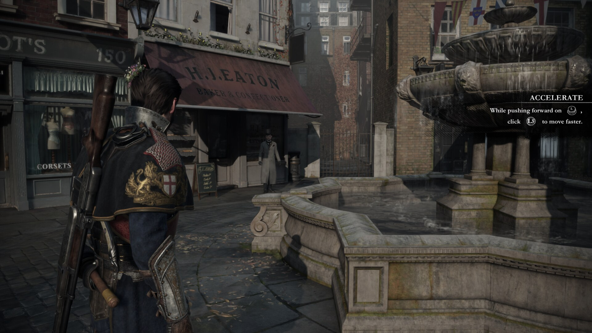
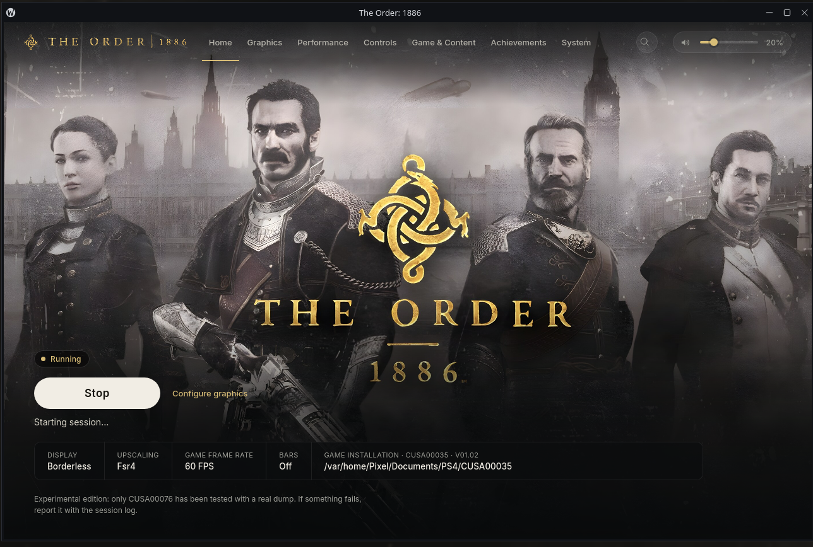
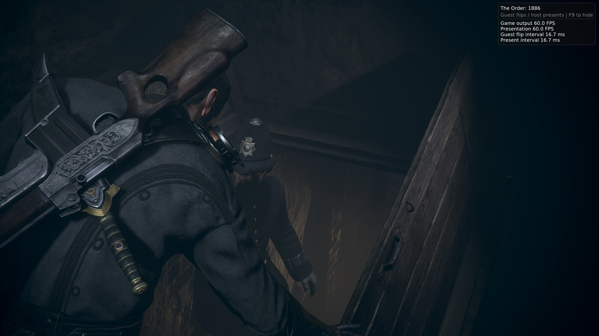
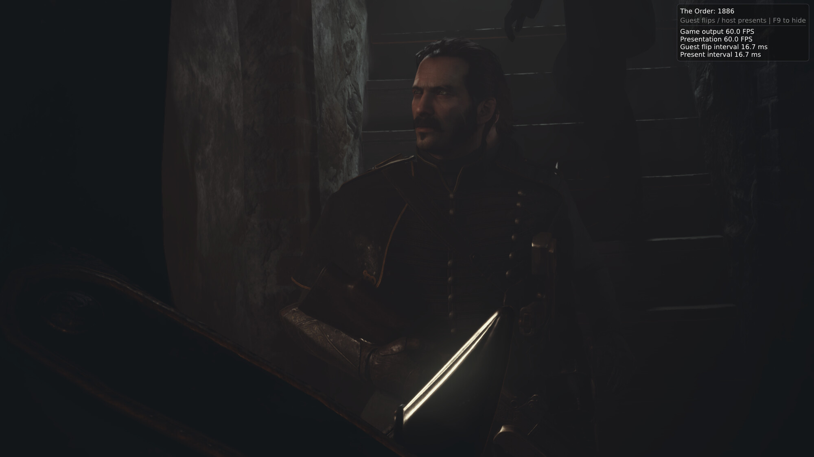

<h1 align="center">The Order: 1886 — Actually Alive</h1>

<i>A PC port of The Order: 1886 that keeps moving: Linux first, Vulkan, FSR 4, 60 FPS, no letterbox.</i>

  
  
  
  
  
  

  <a href="https://github.com/DivinusX/a-port-of-the-order-1886-thats-actually-alive/releases/latest"><b>⬇ Download the latest build</b></a> ·
  <a href="CHANGES.md">Changelog</a> ·
  <a href="QUICKSTART.txt">Quick start</a> ·
  <a href="https://github.com/DivinusX/a-port-of-the-order-1886-thats-actually-alive/issues">Report a problem</a>

---

## Why this exists

The Order: 1886 is one of the best-looking games of its generation, and it has been stuck on
the PS4 since 2015. Community work has already got it booting on PC. I wanted it to be
**playable and pleasant on my own machine**: a Linux desktop with an AMD card, a controller in
hand, no black bars and a steady 60.

So this repo is where I keep pushing it forward. I ship small, frequent releases, each one
fixing something you can actually see, and each one documented with how it was tested.

> **You need your own game.** No game files, firmware or saves are included. Use your own
> extracted PS4 copy of The Order: 1886. This is an unofficial fan project and is not
> affiliated with Sony or Ready at Dawn.

## Screenshots

<table>
  <tr>
    <td colspan="2"></td>
  </tr>
  <tr>
    <td colspan="2" align="center">The launcher: Borderless · <b>FSR 4</b> · <b>60 FPS</b> · <b>Bars off</b>, running a CUSA00035 v1.02 dump</td>
  </tr>
  <tr>
    <td width="50%"></td>
    <td width="50%"></td>
  </tr>
  <tr>
    <td align="center">Gameplay at a locked 60.0 FPS (16.7 ms)</td>
    <td align="center">Cutscene at 60.0 FPS, full 16:9 frame</td>
  </tr>
</table>

## What this build does differently

| | |
| --- | --- |
| 🐧 **Linux first** | Built, tested and released on Linux (RX 9070 XT / Mesa RADV). The runtime and launcher ship as one self-contained package. |
| ✨ **AMD FSR 4** | FSR 4 (v07 ML model) replaces the game's own temporal anti-aliasing, with FSR 3.1 as the automatic fallback when a GPU can't run it. |
| ☀️ **Sun shadows fixed** | The draw-time HTILE expand brings back outdoor sun shadows and wet-stone reflections, without the Chapter I flicker coming back. |
| 🎬 **No letterbox by default** | Graphics → **Cinematic bars** lets you choose. Bars are **off** by default, so the game renders the full 16:9 picture. Your game files are never touched. |
| 🎮 **Controllers that work** | Hot-plug detection, the original PlayStation button layout, keyboard prompts that follow your key bindings, and a built-in pad check that tells you *why* a pad isn't seen. |
| 🎵 **A launcher with a soul** | Background music with a volume bar, a clear Home strip showing your display, upscaler, frame rate and bars at a glance. |
| 📂 **Any dump, any case** | Dumps with mixed-case folder names (CUSA00035 and others) load correctly. |

## Release history

Every release has a full write-up in [CHANGES.md](CHANGES.md), with evidence in
[`docs/verification/`](docs/verification).

| Version | Date | Highlights |
| --- | --- | --- |
| **v0.2.16** | Nov 8, 2026 | Sun shadows and wet-surface specular restored (draw-time HTILE expand); brightness flicker measured at 3 → 0 flips |
| v0.2.15 | Nov 8, 2026 | **AMD FSR 4** replaces the game's TAA on Linux; FSR 3.1 selectable on Linux as fallback |
| v0.2.14 | Nov 7, 2026 | **Cinematic bars** option, bars removed by default |
| v0.2.13 | Nov 7, 2026 | Launcher adjustments; real pad-check diagnostics and CONTROLLERS docs |
| v0.2.12 | Nov 7, 2026 | Controller fixes: Steam grab and HID access guidance |
| v0.2.11 | Nov 7, 2026 | Hot-plug gamepad detection; Xbox controller verified |
| v0.2.10 | Nov 7, 2026 | Chapter I shadow flicker fixed |
| v0.2.9 | Nov 7, 2026 | Original button layout restored; keyboard prompts follow your key mapping |
| v0.2.8 | Nov 7, 2026 | Launcher background music; Linux runtime fix |
| v0.2.7-hotfix.1 | Nov 6, 2026 | Mixed-case game dumps fixed |

## Getting started

1. **Download** the latest `order1886-linux-x86_64-*.tar.gz` from
   [Releases](https://github.com/DivinusX/a-port-of-the-order-1886-thats-actually-alive/releases/latest)
   and check it against the `.sha256` file.
2. **Extract** the whole archive to a writable folder. Keep the entry points and `bin/` together.
3. **Run** `The Order 1886` and pick your game folder on **Game & Content**. Pick the folder
   that directly contains `eboot.bin`, `archivemap.bin`, `_data`, `sce_sys` and `sce_module`.
4. Choose your settings (I play with Borderless + FSR 4 + 60 FPS + bars off) and press **Play**.

**Requirements:** x86-64 Linux, glibc 2.39+, a Vulkan GPU driver. The launcher window needs
WebKitGTK 4.1. Without it (for example on SteamOS), use
`Play The Order 1886 --game-dir /path/to/game` to play directly.

**Supported editions:** update 1.02 of CUSA00076, CUSA00035, CUSA00070, CUSA00100, CUSA00670
and CUSA00785. CUSA00035 is the one I play on.

Settings, caches, logs and saves live in `user/order1886` next to the launcher. Keep that folder
when you upgrade.

Full setup, SteamOS notes and troubleshooting are in [QUICKSTART.txt](QUICKSTART.txt).

## Controllers

Plug the pad in before launching. The runtime logs `Runtime: gamepad connected: <name>`, and
`bin/order1886-runtime --gamepad` checks detection without starting the game. If something's
wrong, look for `Order1886: pad check:` warnings in the log. The usual causes are:

- **No kernel driver loaded.** Updating the kernel without rebooting is the classic cause.
- **Your user can't read the device.** Join the `input` group or install the shipped udev rule.
- **Steam is grabbing it.** Quit Steam, or turn off Steam Input for that controller family.

## Known limits

- 60 FPS is still experimental. Chapters 6 and 9 may softlock on QTEs; switch to 30 FPS for those.
- FSR 4 renders at the game's own size (keep Render resolution on *Original*). Sub-native
  quality modes aren't wired yet.
- Full campaign progression and very long sessions aren't verified end to end.

Found a bug? [Open an issue](https://github.com/DivinusX/a-port-of-the-order-1886-thats-actually-alive/issues)
with your `last-run.json`, the matching session log, your GPU/driver and steps to reproduce.
Check logs for personal paths before you share them, and never upload game files or saves.

## How it works

The original PS4 x86-64 executable runs directly on your CPU. A compatibility runtime
reimplements the PS4 system interfaces the game uses, and a Vulkan video core translates the
PS4 GPU commands and shaders to SPIR-V. The launcher prepares a hash-checked copy of the game
executable (your originals are only read), applies the options you chose and manages
sessions, logs and save backups.

## Credits and license

Licensed under [GPL-2.0-or-later](LICENSE).

This project stands on a lot of community work, and I want to name it:

- [JulioCacko/The-Order-1886_pc](https://github.com/JulioCacko/The-Order-1886_pc): the base
  runtime and launcher this project continues from
- [shadPS4](https://github.com/shadps4-emu/shadPS4): the graphics and PS4 API core
- [FelipePrado0/gow3_pc](https://github.com/FelipePrado0/gow3_pc): loader and build infrastructure
- [IgorAugustoHH/The-Order-1886-PC-Port](https://github.com/IgorAugustoHH/The-Order-1886-PC-Port)
  (TOport): renderer fixes, including the HTILE work
- [mateussmeneses/theorder1886-port](https://github.com/mateussmeneses/theorder1886-port):
  launcher structure and the sun-shadow investigation (#26)
- AMD FidelityFX / [FireBurn/FSR-Vulkan](https://github.com/FireBurn/FSR-Vulkan): the FSR 4 provider (MIT)

Full attribution is in [`notices/ATTRIBUTION.txt`](notices/ATTRIBUTION.txt).

*The Order: 1886* belongs to Sony Interactive Entertainment and Ready at Dawn. This project is
not affiliated with or endorsed by them. No game executable, dump or save is distributed.

---

  

  Maintained by <a href="https://github.com/DivinusX"><b>DivinusX</b></a> 
  If this got the game running for you, a ⭐ helps others find it.

