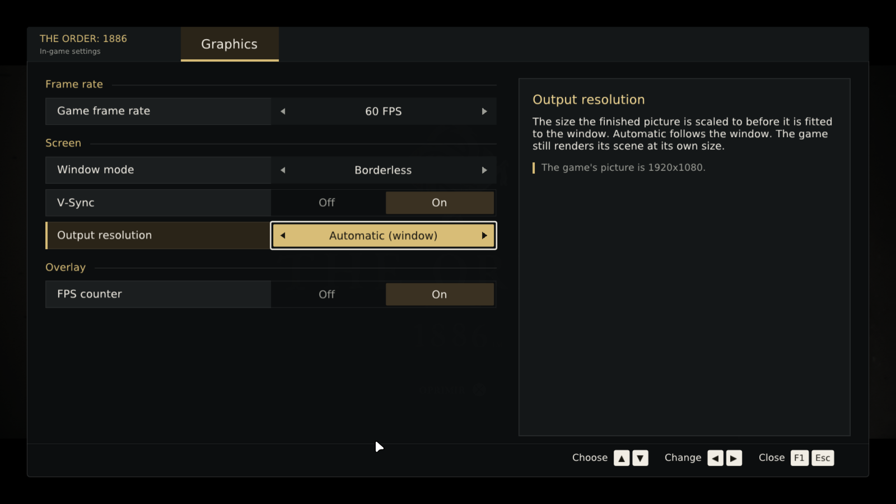
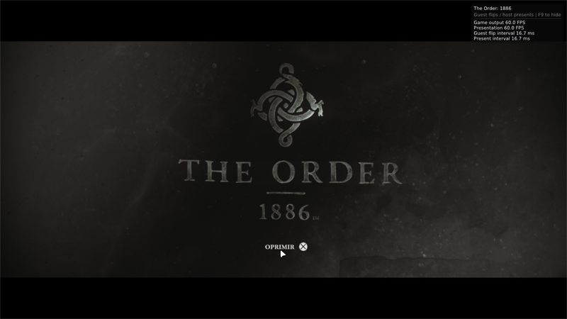

# In-game menu (F1): live graphics settings — 2026-11-14

Runtime patch: [`2026-11-14-in-game-menu.patch`](2026-11-14-in-game-menu.patch), applied after
the four earlier patches on JulioCacko/The-Order-1886_pc `3748288`. The whole build is
`packaging/linux/build-engine.sh`.

## What it does

**F1** (or Insert; **R3+L2** on a controller) opens a Graphics tab over the game. Its layout
follows Longshot's: rows of label | value, a description panel and key hints. Its colours are
the launcher's palette, which follows the game's (charcoal `#0c0e0f`, surfaces `#141718`,
parchment `#f1ede4`, gold `#d8bd77`). Every row applies immediately:

| row | values | how it applies |
|---|---|---|
| Game frame rate | 30 FPS (the console's) / 60 FPS | writes the engine's vblank interval global (below) and moves the presentation cap with it |
| Window mode | Window / Borderless / Fullscreen | `display_mode`, already live (`window.cpp`) |
| V-Sync | Off / On | `vsync`; `Swapchain::UpdateVsync` recreates the swapchain |
| Output resolution | Automatic (window) / 720p / 1080p / 1440p / 2160p | `output_res`, now read every present (below) |
| FPS counter | Off / On | `show_fps` (F9 still toggles it) |

Controls: ▲▼ choose, ◀▶ change, Enter/Space or Cross toggle, F1/Esc or Circle close. The mouse
works too. Changes last for the session.

## How

- **Frame rate.** The interval global at RVA `0x15c0d54` (2 = 30 FPS, 1 = 60 FPS) is the one the
  timing recipes edit (`scripts/order1886_frame_rate.py`).
  - The runtime now tells the GPU library where it loaded the image
    (`ps4gpu_set_guest_image`, called from `probe.c` right after `ps4gpu_init`).
  - `ps4_guest_image.h` hands out the global only when RVA `0x4507be` holds the
    `mov dword [rip+disp32], imm32` that writes it, with immediate 1 or 2, i.e. the verified
    01.02 code. Otherwise the row is shown as unavailable.
  - After the player picks a rate, `Menu::EnforceFrameRate` keeps it every present, because the
    game resets the interval at a few scripted moments.
  - `fps_limit` follows (30 or 60), since the launcher caps presentation at the game frame rate.
- **Output resolution.** `Presenter::SetExpectedGameSize` runs every present and the frame is
  recreated when the expected size changes. It read `startup_output_res`; it now reads
  `output_res`.
- **Menu.** `Menu::Draw` in `ps4_overlay.cpp` draws with ImGui's draw list at a 1080p-relative
  scale. The menu existed upstream as plumbing only (`menu_open`, input capture, the settings
  atomics): its content was removed when the repository became The Order's runtime (`7e16a1d`).
- **Launcher.** `launcher-py-overlay` replaces the old opt-in `in_game_menu` field ("unqualified,
  enable to help test it") with `game_menu`, **on by default**. The launcher saves every key, so
  most players have `in_game_menu=False` stored, and a new default on that key would never apply.

## Verification (Arch, NVIDIA RTX 5050 Laptop, CUSA00035 1.02)

**The engine against v0.2.20's.** Upstream `3748288` with the four earlier patches, before this
menu:
- Same save, same inputs, one sunlit outdoor scene: the same image on both (fog, sun on the
  brick, neon, flags).
- 30.0 FPS on both, 0 faults, 1,901 vs 1,897 files opened, 0 not found.
- Not compared: The Chase (no save there) and FSR 4 (not on this GPU).

**The menu**, through the launcher's own protocol (`settings.set` + `session.start`), with a
player's real settings, which have the old `in_game_menu=False` stored:
- The launch command carried `--in-game-menu`, and F1 opened the menu.
- **Game frame rate 30 → 60:** the overlay went from 30.0 to "Game output 60.0 FPS ·
  Presentation 60.0 FPS · 16.7 ms" without a restart. "Running at 60 FPS" means
  `IntervalGlobal()` verified the instruction.

  
- **V-Sync On → Off:** the session log shows `Swapchain: VSync off (Mailbox)`.
- **Output resolution:** the game's own capture (F12) is 1600x900 with Automatic (the
  window's logical size at 1.2 scale), then 1280x720 right after switching to 1280x720.
- The build has 0 compiler warnings.

**Not verified:**
- Window mode switching from the menu (its live path predates this change).
- Long play at 60 FPS through Chapters 6 and 9.
- AMD and Intel GPUs.
- Closing the window while the menu is open took effect only when the session was stopped.
