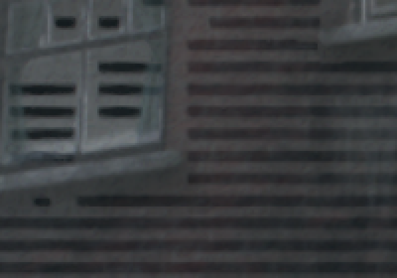

# Black stripes on RX 6600-class GPUs: multisampled depth read by a shader — 2026-11-14

Issue: [#4](https://github.com/DivinusX/a-port-of-the-order-1886-thats-actually-alive/issues/4)
(AMD RX 6600 XT, all default settings, every chapter). Runtime patch:
[`2026-11-14-rdna2-ms-depth-lines.patch`](2026-11-14-rdna2-ms-depth-lines.patch), against
JulioCacko/The-Order-1886_pc `3748288`.

## What the screenshot shows

The 2560x1440 screenshot in #4 (Whitechapel courtyard, red post box and lamp post) has dark
horizontal bands **only where the sun lights a surface**: brick facades, shutters, the
building in the back. Surfaces in shadow are clean.

Measured on the left facade, the dark rows repeat every **10-13 px** (mean about 11). The
game renders at 1920x1080 by default and the screenshot is 2560x1440, a 1.333 scale, so
that period is **8 render rows**. Each dark band is about half the period, **4 rows**. The
bands run horizontally for tens of pixels and stop at light boundaries.

## Cause

This is the fault gow3_pc #65 diagnosed on the same emulation core
(`docs/plans/2026-10-12-gpu-corruption-rdna2.md` upstream, section 10, kalil03): *dark bands
4 rows tall with a period of 8, only inside light footprints, never in shadow*. The game
draws with a multisampled D32S8 depth buffer and a later pass reads it with `texelFetch` on a
`sampler2DMS`. On **AMD's proprietary driver** with RDNA2 (RX 6600 family), that fetch
returns 0 in the lower half of many 8x8 pixel tiles, the ones with little depth variation,
which looks like compressed depth read without being expanded. Lighting, fog and bloom that
use that depth inherit the bands. That is why they follow the light.

gow3_pc fixed it with `GOW3_NO_MSAA`: on that driver, guest multisampled images are created
with 1 sample and their `Color2DMsaa` sharps are treated as `Color2D`. Guest sizes and
addresses keep the real sample count. Five RX 6600/6650 XT owners confirmed it there: lines
on 10 of 11 launches without the patch, 0 of 5 with it.

When this repository became The Order's runtime (`7e16a1d`), the plumbing was kept
(`ImageInfo::guest_samples`, `GuestNumSamples()`, the `Color2DMsaa` -> `Color2D` remap in
`resource.h`, `CopyColorAndDepth`'s `guest_ms_depth` path) but switched off for every driver:
`NoMsaa()` became `return false;` and `vk_instance.cpp` hard-coded `no_msaa = false`. The
regression came back with it.

This also explains why RDNA4 (RX 9070 XT), NVIDIA, RADV and AMDVLK show no stripes: the
fault is in that one driver's read of compressed multisampled depth.

## Fix

- `amdgpu/ps4_msaa.h`: `NoMsaa()` returns the switch again.
- `amdgpu/ps4_msaa_default.h` (new, plain C): `order1886_no_msaa_default()` is true **only
  for `VK_DRIVER_ID_AMD_PROPRIETARY`**. `order1886_no_msaa()` lets `ORDER1886_NO_MSAA=0` or
  `=1` override; any other value means the default.
- `renderer_vulkan/vk_instance.cpp`: decides with those once the driver is known. The log
  says `GPU: guest multisampling on` or `off (single-sampled images for this driver; ...)`.
- `tests/test_order1886_render_baseline.cpp`: the baseline assertion now states the policy.
  The default is off on NVIDIA, RADV, AMDVLK, Mesa ANV, Intel Windows and MoltenVK, and on
  for AMD proprietary. The override and the switch are tested too.

**The native baseline does not change** on any driver except AMD's proprietary one. On that
driver the game's multisampled targets become single-sampled, so the edge coverage those
passes had is lost, which is the trade gow3_pc accepted. Intel's Windows driver had the same
lines in gow3_pc (#28), but nobody has reported them in The Order, so it keeps the baseline
here. `ORDER1886_NO_MSAA=1` exists for anyone who needs it.

`ORDER1886_NO_MSAA` is a diagnostic override for running the runtime directly. The backend
strips inherited `ORDER1886_*` variables (`runtime_process_environment`), so it does not
pass through the launcher. The per-driver default needs no variable.

## Verification

- `ps4_msaa_default.h` builds as C11 (`gcc -Wall -Wextra -Werror`).
- A translation unit with the real `ps4_msaa.h` and `ps4_msaa_default.h`, the new baseline
  assertions, and the `vk_instance.cpp` expression verbatim (with `vk::DriverId`, as
  `driver_id` is declared) builds with `g++` and `clang++` `-std=c++23 -Wall -Wextra -Werror`.
  Every assertion passes: AMD proprietary off by default, RADV and NVIDIA on, and `=0`/`=1`
  override.
- The full `order-render-baseline-test` target and `libps4gpu` were **not** built here
  (Boost and VulkanMemoryAllocator are not installed on this machine). The release build
  must run them.
- **Not run on an RX 6600.** No RDNA2 card is available. The RX 9070 XT (RDNA4) never showed
  the stripes, so it cannot confirm the fix, only that nothing changes there (its driver is
  not AMD proprietary under Linux, and RADV keeps the baseline).

## Test request for #4

A build with this patch, an RX 6600-class card on the Windows AMD driver, the courtyard from
the screenshot:

1. The session log should say `GPU: guest multisampling off (single-sampled images for this
   driver; ...)`.
2. Stripes gone on sunlit surfaces: compare against the screenshot in #4.
3. If they remain: the log line, the driver version (Adrenalin), and whether the reporter is
   on Windows or Linux. On Linux RADV the cause would be a different one, and the default
   deliberately does not change there.
