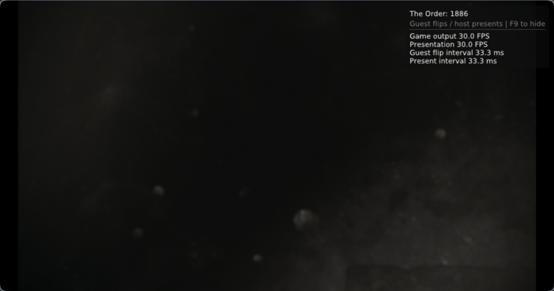

# Windows v0.2.22 — the RDNA2 stripes fix and the November 14 features, built for Windows

Issues: [#4](https://github.com/DivinusX/a-port-of-the-order-1886-thats-actually-alive/issues/4)
(RX 6600 XT, Windows 10, Adrenalin 26.1.11: stripes on sunlit surfaces, on the logos and on
the main menu; the v0.2.18 log says `GPU: guest multisampling on`) and
[#11](https://github.com/DivinusX/a-port-of-the-order-1886-thats-actually-alive/issues/11)
(a Windows build with the `rdna2-ms-depth-lines` and `in-game-menu` patches).

## Where the Windows engine comes from

v0.2.18 was built from `DivinusX/The-Order-1886_pc` branch `windows-port` (upstream
`3748288` + the fork's HTILE expand, staging sun-sync, FSR 4 provider source and the Windows
port commits) by the source repository's `order1886-go-package.yml`: a `windows-2025` runner
with MSYS2 CLANG64 builds `order1886-runtime.exe`, both upscaler provider DLLs, the Wails
launcher and the PyInstaller worker, then `packaging/windows/order1886-go-build.ps1` stages
the tree. The release repository's `packaging/windows/order1886-win-package.py` verifies the
manifest, merges the release documents and writes the zip (see
`2026-11-08-windows-port-runbook.md`).

v0.2.22 is branch `windows-port-v0.2.22` = `windows-port` + three source commits (and the Linux packaging/worker fixes after them):

| commit | what |
| --- | --- |
| `fix(GPU): single-sample guest multisampling on AMD's proprietary driver` | `2026-11-14-rdna2-ms-depth-lines.patch`, applied clean (`git apply --check`) |
| `feat(GPU): in-game menu on F1` | `2026-11-14-in-game-menu.patch`, applied clean |
| `Launcher: game language selector, in-game menu on by default, pre-patched dumps accepted` | the `launcher-py-overlay/` and `scripts/` changes of v0.2.19–v0.2.21, in the source tree |

The third commit is the one that differs from the Linux packages, which carried those
changes as a worker overlay (`repack_worker.py`). Putting them in the source tree ran the
upstream Python suite over them for the first time, which found two things the overlay had
hidden:

1. The language recipe was appended inside `order1886_patches.select()` for every
   preparation and applied like a player-selected recipe, so a prepared image **without**
   the expected bytes at the SKU jump table made the whole preparation fail
   (`expected bytes are absent at 0xa81b00`). On the verified CUSA00035 01.02 dump the bytes
   are there, which is why Linux never showed it; a different build would have been unable
   to start at all. It is now `order1886_patches.language_profile()` /
   `apply_language()`: an explicit step of `prepare_game`, part of the cache fingerprint
   (`language_recipe_sha256`), recorded as `language_profile` in `prepared.json` and in the
   run report, applied when the bytes match and otherwise reported with a `reason`.
2. Two upstream tests encoded the pt-BR → pt-PT substitution (`LANGUAGE_FALLBACKS`); they
   now state the new policy (no substitution; the player picks either Portuguese).

Suite after the change: `python3 -m unittest discover -s tests -p 'test_*.py'` → **603 tests,
OK (62 skipped: GPU, Windows-only and iced-x86 fixtures)**. Before the change: 454 of the
`test_order1886*` subset, OK.

## Build

- Source revision: `bdd172d` for both packages (`bin/runtime-build.json`, `source_dirty: false`). The
  commits after `466b039` are the Linux packaging and worker fixes listed in CHANGES.md (providers and
  the pad-check wrapper staged, the receipt naming the wrapper's hash, the marker kept out of the
  manifest, the worker's `LD_LIBRARY_PATH` no longer inherited by the game).
- CI run: https://github.com/DivinusX/The-Order-1886_pc/actions/runs/43678050101
- Artifact `order1886-go-package` → `order1886-win-package.py --version v0.2.22 --extra …`
- `order1886-win-x86_64-v0.2.22.zip`: its `.sha256` ships beside it on the release page (it cannot be
  written here, since this file is inside the zip).
- Linux: `order1886-go-linux-package.yml` run https://github.com/DivinusX/The-Order-1886_pc/actions/runs/43678115443
  (ubuntu-24.04, clang 18, glibc 2.39) → `packaging/linux/order1886-linux-package.py --version v0.2.22` with the
  FSR 4 bundle and music of v0.2.21 and these documents merged in; `order1886-bundle.py check` passes.

## Verification

**wine on this Linux machine (NVIDIA RTX 5050, prime-run), the CI artifact's `order1886-runtime.exe`:**

- `--runtime-info` answers (`runtime_abi order1886-native-1`, `prepared_format PS4BOOT5`).
- Booted directly (`build_command` + `runtime_environment` from the source tree, paths as `Z:\…`)
  against the CUSA00035 dump with the prepared image of the Linux install: window up, FSR 3.1
  provider loaded, `HTILE:` lines, flips at 30.0 FPS for the full 150 s run, no missing files, no
  faults. The log says `GPU: using NVIDIA GeForce RTX 5050 Laptop GPU` and
  **`GPU: guest multisampling on`**: the per-driver default leaves NVIDIA alone, as designed.

  

- With `ORDER1886_NO_MSAA=1` the same binary prints
  **`GPU: guest multisampling off (single-sampled images for this driver; ORDER1886_NO_MSAA=0 keeps it)`**,
  which is the line an RX 6600 owner should see without any variable. Every wine boot after the
  first one, with or without the variable (three with, one control without), stopped at the first
  `vkAcquireNextImageKHR` with `VK_NOT_READY` — a result the specification does not allow for the
  infinite timeout the presenter uses, so this is wine's presentation on this stack, not the
  build. The single-sample path therefore rendered no frames under wine; on Linux the same code
  runs in v0.2.21 (where `ORDER1886_NO_MSAA=1` was not exercised either).
- The launcher window (`The Order 1886.exe`) asks for the WebView2 runtime under wine, as on a
  Windows 10 without it; the direct-play entry point was not used because the worker refuses a
  game folder under wine's `Z:\` drive (it is a reparse point to the worker's link check).

**Linux package, this machine:** **Linux package booted the game on this machine** (Arch, NVIDIA RTX 5050, CUSA00035 dump, direct play): fresh preparation with the language edit applied (`language_profile.applied: true`, `87fbffff → 98fbffff`), `ORDER1886_LANGUAGE=20`, `ORDER1886_SETTINGS_MENU=1`, no `LD_LIBRARY_PATH` handed to the runtime, `GPU: guest multisampling on` (NVIDIA keeps the baseline), HTILE expand firing, 0 files not found, clean exit 0 on close. At native render size the CI-built FSR 4 provider loads (`AMD FSR 4 v07 INT8/DOT4 (source) available`) and reconstructs frames; at a lower render size the backend presents 1:1 without an upscaler, by design.

**Not verified: the stripes on an RX 6600.** No RDNA2 card is available here. The evidence
for the fix is the one in `2026-11-14-rdna2-ms-depth-lines.md`: the measured 8-row period /
4-row bands in the reporter's screenshot match the known AMD-proprietary RDNA2 fault, the
same switch removed the lines for five RX 6600 / 6650 XT owners of another PS4 port on this
emulator core, and the per-driver default is unit-tested. The reporter's second batch of
screenshots (logos and main menu striped "like an old TV") is consistent with the cause:
those screens go through the same lighting and post passes that read the multisampled depth.

## Test request for #4 and #11

1. Extract v0.2.22, copy your `user` folder over, start the game.
2. The newest `user/order1886/logs/*-boot.log` should contain
   `GPU: guest multisampling off (single-sampled images for this driver; ...)`.
3. Compare the Whitechapel courtyard and the main menu with the v0.2.18 screenshots.
